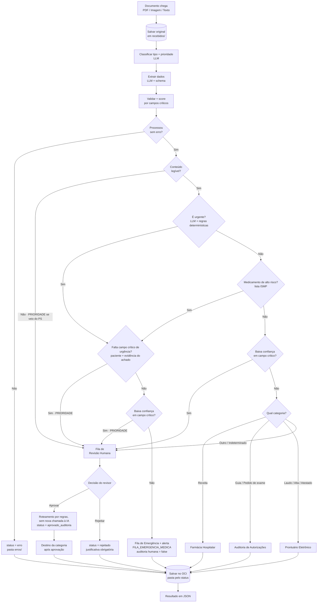

<div align="center">

# 🏥 MediFlow
### Agente Autônomo para Triagem, Extração e Roteamento de Documentos Clínicos


_Hackathon ONE · Oracle Next Education & Alura · G10 Brasil — Equipo 3_

</div>

---

## 📑 Índice

- [💡 Qual a nossa solução?](#-qual-a-nossa-solução)
- [🌐 Nosso Website / Demonstração](#-nosso-website--demonstração)
- [🔄 Fluxo do Aplicativo](#-fluxo-do-aplicativo)
- [🛠️ Tecnologias Utilizadas](#️-tecnologias-utilizadas)
- [🏗️ Estrutura do Projeto](#️-estrutura-do-projeto)
- [🚀 Como Executar](#-como-executar)
- [👥 Equipe (Grupo 10 - ONE)](#-equipe-grupo-10---one)
- [📄 Licença](#-licença)

---

## 💡 Qual a nossa solução?

Hospitais, clínicas e laboratórios recebem todos os dias um volume enorme de receitas, laudos, guias e atestados. Hoje, equipes administrativas leem esses documentos **à mão** e digitam os dados em sistemas antigos — um processo lento, caro e sujeito a erros de transcrição que atrasam o atendimento, inclusive de casos urgentes.

O **MediFlow** é um agente autônomo que automatiza essa triagem. Ele recebe o documento clínico, entende o que é, extrai os dados essenciais e o encaminha ao setor certo — chamando um **humano** sempre que a leitura é duvidosa (*Human-in-the-Loop*).

Em uma frase: **documento entra → a IA classifica e extrai → o sistema mede confiança e urgência → roteia (emergência, setor ou revisão humana) → grava tudo em JSON no OCI.**

O agente avalia **dois eixos independentes**:

- 🚨 **Prioridade clínica** (o perigo) — decidida pela LLM lendo o conteúdo, reforçada por regras determinísticas (ex.: medicamentos de alto risco da lista ISMP).
- 🎯 **Confiança da extração** (a certeza) — medida nos **campos críticos** (CRM, medicamento, dosagem, diagnóstico).

Um documento urgente com leitura duvidosa **não** é enviado direto à emergência: vai para a revisão humana **com prioridade**, para que um profissional confirme antes de acionar o alerta.

> ⚠️ O MediFlow é uma ferramenta de **triagem administrativa**. A classificação da IA não é um diagnóstico médico — casos duvidosos ou de alto risco sempre passam por um profissional. Todos os testes usam **documentos sintéticos**, nunca dados reais de pacientes.

## 🌐 Nosso Website / Demonstração

- 🚀 **Demonstração Online:** Em breve
- 📺 **Vídeo de Apresentação:** Em breve


## 🔄 Fluxo do Aplicativo



## 🛠️ Tecnologias Utilizadas

| Camada | Tecnologia |
|---|---|
| Linguagem (backend) | Python 3.11+ |
| API REST | FastAPI |
| Validação de dados | Pydantic |
| IA / LLM | Groq (`groq`), Google Gemini (`google-genai`) e provedor mock |
| Leitura de PDF | PyMuPDF |
| Tratamento de imagem | Pillow |
| Armazenamento | OCI Object Storage (camada Always Free) |
| Frontend | React |
| Testes | pytest |

## 🏗️ Estrutura do Projeto

```text
G10-BRASIL-EQUIPO-3/
├── backend/        # API, agente, regras de triagem e integração com o OCI
├── frontend/       # Interface web (React)
├── docs/           # Documentação, diagramas e decisões de projeto
├── tests/          # Testes automatizados e documentos sintéticos de exemplo
├── video/          # Material da demonstração
├── requirements.txt
├── LICENSE
└── README.md
```


## 🚀 Como Executar

### Pré-requisitos

- Python 3.11 ou superior;
- Git;
- Acesso ao terminal;
- Credenciais de serviços externos somente quando utilizar Groq, Gemini ou OCI.

As instruções abaixo descrevem a execução local do backend.

### 1. Clonar o repositório

```bash
git clone https://github.com/No-Country-simulation/G10-BRASIL-EQUIPO-3.git
cd G10-BRASIL-EQUIPO-3
```

### 2. Criar e ativar o ambiente virtual

No Windows (PowerShell):

```powershell
python -m venv .venv
.\.venv\Scripts\Activate.ps1
```

### 3. Instalar as dependências

Na raiz do projeto:

```powershell
python -m pip install -r requirements.txt
```

### 4. Configurar as variáveis de ambiente

Entre na pasta do backend:

```powershell
cd backend
```

Crie uma cópia do arquivo de exemplo:

```powershell
if (-not (Test-Path .env)) {
    Copy-Item env.example .env
}
```

Para executar sem acessar provedores externos, utilize:

```env
LLM_PROVIDER=mock
STORAGE_BACKEND=mock
```

Para utilizar o Groq:

```env
LLM_PROVIDER=groq
LLM_MODEL=qwen/qwen3.8-27b
GROQ_API_KEY=SUA_CHAVE_AQUI
```

O modelo indicado foi utilizado nos testes integrados do MediFlow. Sua disponibilidade depende da conta e do provedor.

Para utilizar OCI Object Storage:

```env
STORAGE_BACKEND=oci
OCI_NAMESPACE=SEU_NAMESPACE
OCI_REGION=SUA_REGIAO
OCI_BUCKET=SEU_BUCKET
OCI_CONFIG_PROFILE=DEFAULT
```

A integração com OCI também requer configuração local do SDK e credenciais de acesso autorizadas.

**Segurança:** nunca versionar o arquivo `.env`, chaves de API ou credenciais da OCI. Utilizar somente documentos sintéticos durante os testes.

### 5. Iniciar a API

Ainda na pasta `backend`, execute:

```powershell
python -m uvicorn app.main:app --port 8000
```

Acesse a documentação interativa:

http://127.0.0.1:8000/docs

### 6. Testar a triagem pelo Swagger

No Swagger UI, utilize:

`POST /api/v1/documents/triage/upload`

Envie um documento sintético e informe os parâmetros:

- `arquivo`: documento para processamento;
- `tipo_arquivo`: tipo do arquivo enviado;
- `canal_origem`: canal de recebimento;
- `documento_id`: opcional.

A resposta contém classificação, dados extraídos, validações e decisão de roteamento.

Para recuperar um documento processado, utilize:

`GET /api/v1/documents/{documento_id}`

### 7. Executar os testes automatizados

Em outro terminal, com o ambiente virtual ativado, acesse a pasta `backend`.

Para executar os testes com o armazenamento mock, sem utilizar a OCI real:

```powershell
$env:STORAGE_BACKEND = "mock"
python -m pytest -q
Remove-Item Env:STORAGE_BACKEND
```

Na última execução validada, a suíte apresentou **179 testes aprovados**. Os resultados podem variar conforme novas alterações no código.

### 8. Executar o frontend integrado ao backend

Com a API rodando em `http://localhost:8000` (passo 5), em outro terminal:

```bash
cd frontend
npm install
cp .env.example .env
npm run dev          # http://localhost:5173
```

Detalhes (rotas, login opcional, CORS e limitações): [`docs/INTEGRACAO_BACKEND.md`](docs/INTEGRACAO_BACKEND.md).

### 9. Documentação dos testes integrados

- [Fase 8 — Testes integrados com OCI](backend/docs/testes-integracao-fase8.md)
- [Testes com Groq real e OCI](backend/docs/testes-integracao-groq.md)

Os testes com Groq confirmaram classificação, extração, validação, roteamento, persistência na OCI e recuperação pela API utilizando um documento fictício.

### Observação

O MediFlow é uma ferramenta de triagem administrativa. Os resultados gerados por IA não substituem avaliação ou decisão de profissionais de saúde.


## 👥 Equipe (Grupo 10 - ONE)

**Project Manager**

- Pedro Henrique Costa Silva ([@phc-s](https://github.com/phc-s))

**Architect (Software / Solution Architect)**

- Luís Felipe Barbosa Ferreira ([@oLuisFelipeFerreira](https://github.com/oLuisFelipeFerreira))

**Backend Developer**

- Stefane Oliveira Da Silva Santos ([@Stefane-7](https://github.com/Stefane-7))
- Mariana Rodrigues de Oliveira Amorim Silva
- Otávia Garcia de Souza Longo

**Frontend Developer**

- Geovanna Nunes ([@GeovannaApNunes](https://github.com/GeovannaApNunes))
- Francielle Neves

**Full Stack Developer**

- Gisele Santos de Lima ([@Gisele-L](https://github.com/Gisele-L))
- Yuri Rodrigues Lombardi ([@yuriRLombardi](https://github.com/yuriRLombardi))
- Luís Otávio Santana de Oliveira

## 📄 Licença

Este projeto está licenciado sob a licença **MIT**. Sinta-se à vontade para usar, modificar e contribuir para o projeto.

- [Ver LICENSE](https://github.com/No-Country-simulation/G10-BRASIL-EQUIPO-3/blob/main/LICENSE)
