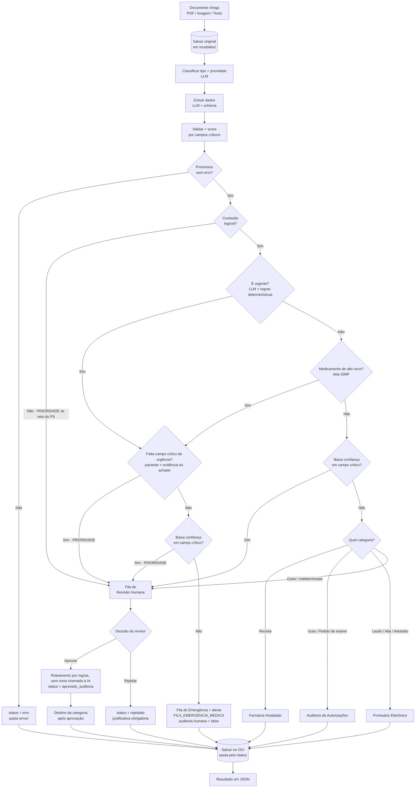

<div align="center">

# 🏥 MediFlow
### Agente Autônomo para Triagem, Extração e Roteamento de Documentos Clínicos


_Hackathon ONE · Oracle Next Education & Alura · G10 Brasil — Equipo 3_

</div>

---

## 📑 Índice

- [💡 Qual a nossa solução?](#-qual-a-nossa-solução)
- [🌐 Nosso Website / Demonstração](#-nosso-website--demonstração)
- [🔄 Fluxo do Aplicativo](#-fluxo-do-aplicativo)
- [🛠️ Tecnologias Utilizadas](#️-tecnologias-utilizadas)
- [🏗️ Estrutura do Projeto](#️-estrutura-do-projeto)
- [🚀 Como Executar](#-como-executar)
- [👥 Equipe (Grupo 10 - ONE)](#-equipe-grupo-10---one)
- [📄 Licença](#-licença)

---

## 💡 Qual a nossa solução?

Hospitais, clínicas e laboratórios recebem todos os dias um volume enorme de receitas, laudos, guias e atestados. Hoje, equipes administrativas leem esses documentos **à mão** e digitam os dados em sistemas antigos — um processo lento, caro e sujeito a erros de transcrição que atrasam o atendimento, inclusive de casos urgentes.

O **MediFlow** é um agente autônomo que automatiza essa triagem. Ele recebe o documento clínico, entende o que é, extrai os dados essenciais e o encaminha ao setor certo — chamando um **humano** sempre que a leitura é duvidosa (*Human-in-the-Loop*).

Em uma frase: **documento entra → a IA classifica e extrai → o sistema mede confiança e urgência → roteia (emergência, setor ou revisão humana) → grava tudo em JSON no OCI.**

O agente avalia **dois eixos independentes**:

- 🚨 **Prioridade clínica** (o perigo) — decidida pela LLM lendo o conteúdo, reforçada por regras determinísticas (ex.: medicamentos de alto risco da lista ISMP).
- 🎯 **Confiança da extração** (a certeza) — medida nos **campos críticos** (CRM, medicamento, dosagem, diagnóstico).

Um documento urgente com leitura duvidosa **não** é enviado direto à emergência: vai para a revisão humana **com prioridade**, para que um profissional confirme antes de acionar o alerta.

> ⚠️ O MediFlow é uma ferramenta de **triagem administrativa**. A classificação da IA não é um diagnóstico médico — casos duvidosos ou de alto risco sempre passam por um profissional. Todos os testes usam **documentos sintéticos**, nunca dados reais de pacientes.

## 🌐 Nosso Website / Demonstração

- 🚀 **Demonstração Online:** Em breve
- 📺 **Vídeo de Apresentação:** Em breve


## 🔄 Fluxo do Aplicativo



## 🛠️ Tecnologias Utilizadas

| Camada | Tecnologia |
|---|---|
| Linguagem (backend) | Python 3.11+ |
| API REST | FastAPI |
| Validação de dados | Pydantic |
| IA / LLM | Google Gemini Flash (`google-genai`) |
| Leitura de PDF | PyMuPDF |
| Tratamento de imagem | Pillow |
| Armazenamento | OCI Object Storage (camada Always Free) |
| Frontend | React |
| Testes | pytest |

## 🏗️ Estrutura do Projeto

```text
G10-BRASIL-EQUIPO-3/
├── backend/        # API, agente, regras de triagem e integração com o OCI
├── frontend/       # Interface web (React)
├── docs/           # Documentação, diagramas e decisões de projeto
├── tests/          # Testes automatizados e documentos sintéticos de exemplo
├── video/          # Material da demonstração
├── requirements.txt
├── LICENSE
└── README.md
```

## 🚀 Como Executar

_Em breve._ As instruções de instalação e execução serão adicionadas assim que os pontos de entrada da API e do frontend estiverem definidos.

## 👥 Equipe (Grupo 10 - ONE)

**Project Manager**

- Pedro Henrique Costa Silva ([@phc-s](https://github.com/phc-s))

**Architect (Software / Solution Architect)**

- Luís Felipe Barbosa Ferreira ([@oLuisFelipeFerreira](https://github.com/oLuisFelipeFerreira))

**Backend Developer**

- Stefane Oliveira Da Silva Santos ([@Stefane-7](https://github.com/Stefane-7))
- Mariana Rodrigues de Oliveira Amorim Silva
- Otávia Garcia de Souza Longo

**Frontend Developer**

- Geovanna Nunes ([@GeovannaApNunes](https://github.com/GeovannaApNunes))
- Francielle Neves

**Full Stack Developer**

- Gisele Santos de Lima ([@Gisele-L](https://github.com/Gisele-L))
- Yuri Rodrigues Lombardi ([@yuriRLombardi](https://github.com/yuriRLombardi))
- Luís Otávio Santana de Oliveira

## 📄 Licença

Este projeto está licenciado sob a licença **MIT**. Sinta-se à vontade para usar, modificar e contribuir para o projeto.

- [Ver LICENSE](https://github.com/No-Country-simulation/G10-BRASIL-EQUIPO-3/blob/main/LICENSE)
