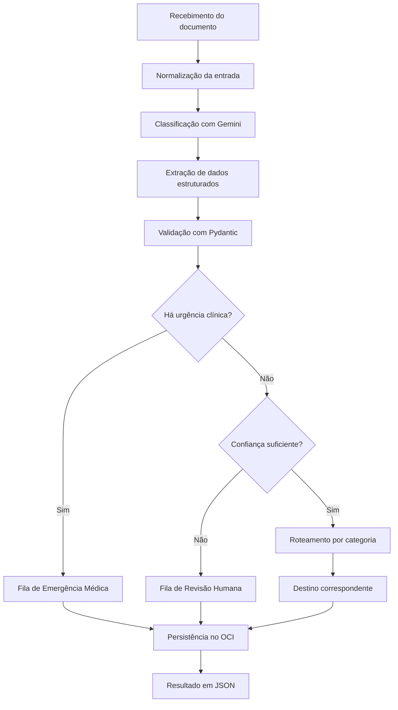

# MediFlow — Agente Inteligente de Triagem Clínica

**Hackathon ONE · Grupo 3**

## 1. Sobre o projeto

O MediFlow é um sistema inteligente desenvolvido para automatizar a triagem, a extração de informações e o roteamento de documentos clínicos e administrativos.

A solução utiliza Inteligência Artificial Generativa para identificar o tipo de documento recebido, extrair informações relevantes, avaliar a consistência dos dados e direcionar cada documento ao setor apropriado.

Quando são identificados dados incompletos, inconsistências ou baixa confiança na extração, o sistema encaminha o caso para revisão humana (*Human-in-the-Loop*).

O projeto tem como objetivo reduzir o trabalho manual, minimizar erros de transcrição e contribuir para maior agilidade no processamento documental em hospitais, clínicas, laboratórios e operadoras de saúde.

## 2. Problema e justificativa

Instituições de saúde recebem diariamente grandes volumes de receitas médicas, laudos, pedidos de exames, guias de autorização e relatórios clínicos.

O processamento manual desses documentos pode gerar atrasos, erros de digitação, dificuldades de organização e demora no encaminhamento de solicitações prioritárias.

O MediFlow propõe automatizar parte desse processo por meio de um agente inteligente capaz de interpretar documentos, estruturar informações e aplicar regras de decisão para definir o encaminhamento adequado.

## 3. Objetivos

### 3.1. Objetivo geral

Desenvolver um MVP de um agente inteligente capaz de receber documentos clínicos, classificá-los, extrair dados estruturados e realizar o roteamento automatizado conforme regras de prioridade e confiança.

### 3.2. Objetivos específicos

- Receber documentos em texto, PDF e imagem.
- Classificar automaticamente os tipos de documentos.
- Extrair dados clínicos e administrativos relevantes.
- Validar a estrutura e a consistência das informações.
- Identificar situações urgentes e casos que exigem revisão humana.
- Encaminhar os documentos aos destinos definidos.
- Armazenar documentos e resultados no Oracle Cloud Infrastructure (OCI) Object Storage.
- Disponibilizar uma interface para envio, consulta e revisão dos resultados.
- Validar o funcionamento por meio de testes automatizados e cenários demonstrativos.

## 4. Tecnologias e ferramentas

| Tecnologia | Finalidade |
|---|---|
| Python | Linguagem principal do backend e do processamento |
| Google Gemini Flash | Classificação documental e extração estruturada por IA |
| `google-genai` | Integração com a API do Gemini |
| Pydantic | Validação dos dados e dos modelos de entrada e saída |
| FastAPI | Criação da API REST para recebimento e processamento dos documentos |
| PyMuPDF | Leitura e processamento de PDFs |
| Pillow | Tratamento de imagens |
| OCI Python SDK (`oci`) | Integração com o Oracle Cloud Object Storage |
| React | Desenvolvimento da interface web principal |
| Streamlit | Interface complementar para triagem e revisão humana, caso adotada |
| LangGraph | Orquestração do grafo de decisão, caso adotado |
| pytest | Testes automatizados |

**Observação:** a seleção final das ferramentas de interface e orquestração deverá refletir as decisões da equipe. A presença de uma tecnologia nesta lista não significa, por si só, que sua integração já foi concluída.

## 5. Arquitetura da solução

A arquitetura proposta é composta por quatro partes principais:

1. **Interface web:** permite enviar documentos e visualizar os resultados da triagem.
2. **API e processamento:** recebe os arquivos, normaliza as entradas e coordena a execução do agente.
3. **Agente inteligente:** utiliza o Gemini para classificar documentos e extrair informações, aplica validações e executa as regras de roteamento.
4. **Armazenamento em nuvem:** utiliza o OCI Object Storage para persistir os documentos e os resultados do processamento.

A comunicação entre os componentes deverá utilizar estruturas de dados definidas e validadas com Pydantic.

## 6. Fluxo de processamento

O pipeline do MediFlow está organizado em seis etapas:

1. **Ingestão:** recebe o documento em formato suportado e prepara o conteúdo para processamento.
2. **Classificação:** identifica a categoria documental e a prioridade clínica.
3. **Extração:** obtém os dados disponíveis, como paciente, médico solicitante, CRM, diagnóstico, CID-10, medicamentos e exames.
4. **Validação:** verifica a estrutura dos dados, a consistência das informações e os indicadores de confiança.
5. **Roteamento:** determina o destino conforme as regras de prioridade, confiança e categoria documental.
6. **Persistência:** armazena o documento e o resultado estruturado no OCI Object Storage.

### Diagrama do fluxo



O diagrama representa o fluxo proposto. A implementação deverá garantir que a baixa confiança também seja avaliada nos documentos urgentes, sem impedir o encaminhamento prioritário de casos potencialmente graves.

## 7. Regras de decisão e roteamento

O agente deverá considerar dois fatores independentes:

- **Prioridade clínica:** indica se o documento contém informações que exigem atenção urgente.
- **Confiança da extração:** indica o grau de confiabilidade atribuído à leitura dos dados.

A revisão humana não deve ser tratada como um nível de prioridade clínica, mas como uma necessidade de validação por uma pessoa.

| Cenário | Decisão esperada |
|---|---|
| Documento de rotina com confiança suficiente | Roteamento automático para o destino correspondente |
| Documento com indicação de urgência | Encaminhamento prioritário e geração de alerta conforme as regras definidas |
| Documento ambíguo ou com confiança insuficiente | Encaminhamento para revisão humana |
| Documento com erro de processamento | Registro do erro e tratamento de contingência |

O limiar de confiança deverá ser configurável. O valor de referência de 0,80 consta no guia do projeto e precisa ser confirmado pela equipe antes da implementação definitiva.

A pontuação produzida pelo modelo deverá ser tratada como um indicador de confiança, não como garantia estatística de correção clínica.

### Destinos previstos

- `Fila_Emergencia_Medica`
- `Auditoria_Autorizacoes`
- `Farmacia_Hospitalar`
- `Prontuario_Eletronico`
- `Fila_Revisao_Humana`

Os identificadores internos deverão permanecer estáveis, independentemente dos nomes apresentados na interface.

## 8. Contrato de dados

O sistema utilizará estruturas JSON para representar a entrada e a resposta do processamento. O arquivo `schema.py` define os modelos Pydantic iniciais.

### Entrada

A entrada contempla os seguintes campos:

- `documento_id`: identificador do documento.
- `tipo_arquivo`: formato informado, como PDF, imagem ou texto.
- `documento_texto`: conteúdo textual, quando disponível.
- `documento_base64`: conteúdo codificado do arquivo, quando utilizado.
- `canal_origem`: origem do documento, quando informada.

### Saída

A resposta está organizada em quatro blocos principais:

- `classificacao`: tipo documental, especialidade, prioridade e confiança da classificação.
- `dados_extraidos`: informações do paciente, profissional solicitante e dados clínicos identificados.
- `decisao_roteamento`: destino, necessidade de auditoria, justificativa e eventual notificação.
- `armazenamento_oci`: bucket, caminho do objeto e estado da persistência.

Os modelos também incluem um identificador do documento e o status do processamento.

O schema deverá ser atualizado conforme a evolução dos requisitos, incluindo os campos necessários para medicamentos, dosagens, confiança por campo, estados de revisão e registro de erros, quando aplicáveis.

## 9. Armazenamento no OCI Object Storage

O Oracle Cloud Infrastructure Object Storage será utilizado para armazenar os documentos recebidos e os resultados da triagem.

A organização deverá separar os arquivos de acordo com seu estado de processamento, utilizando uma estrutura lógica equivalente a:

```text
mediflow-documentos-clinicos/
├── recebidos/
├── processados/
├── auditoria_humana/
└── erros/
```

A estrutura representa uma proposta de organização; sua implementação deverá ser compatível com os buckets e caminhos efetivamente configurados no OCI.

A integração com o serviço de armazenamento é um requisito obrigatório do MVP. O desenvolvimento deverá respeitar os limites da camada Always Free previstos para o projeto.

## 10. Requisitos funcionais

- **RF-01:** receber documentos em formatos suportados.
- **RF-02:** identificar o tipo documental e a prioridade clínica.
- **RF-03:** extrair dados clínicos e administrativos relevantes.
- **RF-04:** identificar ambiguidades, inconsistências e dados faltantes.
- **RF-05:** encaminhar os documentos ao destino correspondente.
- **RF-06:** gerar uma resposta estruturada em JSON.
- **RF-07:** persistir documentos e resultados no OCI Object Storage.
- **RF-08:** permitir a revisão humana dos casos sinalizados.

Os requisitos RF-06, RF-07 e RF-08 complementam a operacionalização do MVP descrito no guia do projeto.

## 11. Requisitos não funcionais

- **RNF-01 — Linguagem:** desenvolver o backend em Python.
- **RNF-02 — Modelo de IA:** utilizar uma API de modelo de linguagem compatível com os requisitos do projeto.
- **RNF-03 — Validação:** manter os dados de entrada e saída em estruturas validadas.
- **RNF-04 — Manutenibilidade:** organizar o código em módulos com responsabilidades definidas.
- **RNF-05 — Tratamento de falhas:** prever erros de processamento e caminhos de contingência.
- **RNF-06 — Segurança:** proteger documentos clínicos e credenciais de acesso.
- **RNF-07 — Armazenamento:** utilizar os recursos de nuvem permitidos pelo programa.
- **RNF-08 — Testabilidade:** permitir a execução de testes automatizados dos fluxos principais.

## 12. Plano de testes e demonstração

O MVP deverá demonstrar pelo menos três cenários:

### Cenário 1 — Documento de rotina

Um documento legível é recebido, classificado, validado e encaminhado automaticamente para o destino correspondente.

**Resultado esperado:** dados estruturados válidos e registro do processamento.

### Cenário 2 — Urgência clínica

Um documento sintético contém informações que, conforme as regras de triagem definidas, indicam possível urgência.

**Resultado esperado:** encaminhamento prioritário e geração do alerta previsto. A automação não substitui a avaliação clínica profissional.

### Cenário 3 — Documento ambíguo

Um documento sintético apresenta campos ilegíveis, informações faltantes ou baixa confiança na extração.

**Resultado esperado:** encaminhamento para revisão humana, sem aprovação automática dos dados incertos.

Os testes automatizados com `pytest` deverão verificar, entre outros aspectos, a validação do schema, as regras de roteamento, o tratamento de erros e os diferentes cenários de processamento.

## 13. Segurança e limitações

O MediFlow é um projeto de automação documental e triagem administrativa. A classificação produzida pela IA não deve ser considerada um diagnóstico médico definitivo.

Para proteger informações sensíveis, o desenvolvimento deverá priorizar:

- Utilização de documentos sintéticos nos testes e demonstrações.
- Proteção das credenciais por variáveis de ambiente ou mecanismos apropriados de gerenciamento de segredos.
- Controle de acesso aos documentos armazenados.
- Evitar registrar informações pessoais e clínicas desnecessárias em logs.
- Encaminhar casos incertos para avaliação humana.
- Tratar possíveis falhas de integração e indisponibilidade dos serviços.

O uso de documentos clínicos reais exigirá controles de segurança, privacidade e conformidade adequados, incluindo a legislação aplicável de proteção de dados.

## 14. Como executar

As instruções definitivas deverão ser preenchidas após a organização do repositório e a implementação dos componentes.

### Pré-requisitos

- Python em versão compatível com as dependências do projeto.
- Node.js e npm, caso seja utilizado o frontend React.
- Chave de API do Google Gemini.
- Configuração de acesso ao OCI Object Storage.
- Dependências listadas nos arquivos de configuração do projeto.

### Instalação prevista

```bash
git clone <URL_DO_REPOSITORIO>
cd mediflow

python -m venv .venv
```

Ativação do ambiente virtual:

**Windows (PowerShell):**

```powershell
.venv\Scripts\Activate.ps1
```

**Linux/macOS:**

```bash
source .venv/bin/activate
```

Instalação das dependências, após a criação do arquivo correspondente:

```bash
pip install -r requirements.txt
```

Os comandos para iniciar a API, o frontend e o painel de auditoria deverão ser adicionados quando os respectivos pontos de entrada estiverem definidos.

**Importante:** as instruções acima são um modelo inicial e pressupõem que o repositório e o arquivo `requirements.txt` sejam criados.

## 15. Estrutura sugerida do repositório

```text
mediflow/
├── backend/
│   ├── main.py
│   ├── schema.py
│   ├── services/
│   ├── agent/
│   ├── routing/
│   └── storage/
├── frontend/
│   └── src/
├── tests/
├── docs/
│   └── arquitetura.md
├── .env.example
├── .gitignore
├── requirements.txt
└── README.md
```

A estrutura é uma proposta inicial e deverá acompanhar a organização real do código. Caso o Streamlit seja utilizado, seu painel poderá ficar em um módulo próprio.

## 16. Equipe e informações do projeto

**Projeto:** MediFlow  
**Programa:** Oracle Next Education (ONE) + Alura  
**Equipe:** Grupo 3  
---

*Este documento deverá ser atualizado conforme os componentes forem implementados, testados e integrados. Requisitos planejados não devem ser apresentados como funcionalidades concluídas antes de sua validação.*
