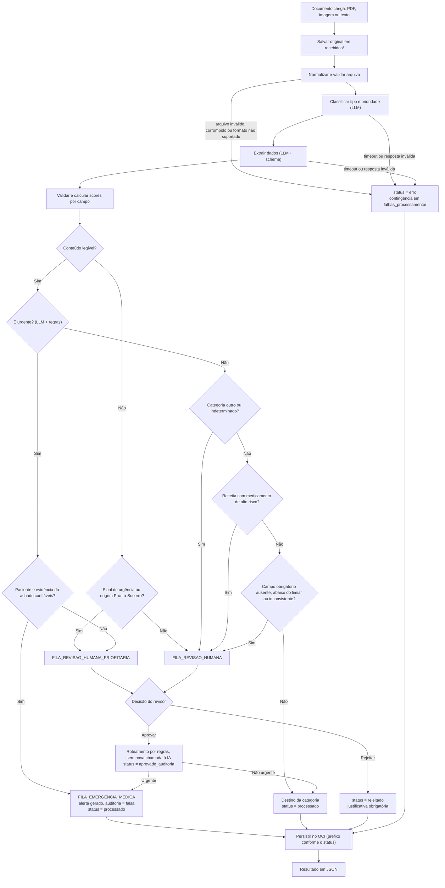

# MediFlow — Plano completo do backend

**Projeto:** MediFlow — Agente Inteligente de Triagem Clínica
**Programa:** Hackathon ONE (Oracle Next Education + Alura)
**Escopo deste documento:** backend (Python). A interface React é desenvolvida por outros integrantes da equipe.
**Estado:** Fases 0 a 7 implementadas na branch `dev`. As Fases 5 e 6 foram integradas pelo merge `0c46772` (PR #1). A Fase 7 integrou o adaptador OCI ao FastAPI e foi validada pelo usuário com documento sintético: gravação e leitura de objetos, persistência após reiniciar a API, `404` para documento ausente e `409` para identificador duplicado. A análise real foi identificada como Groq.

**Última atualização:** 13/11/2026.

> Este documento consolida o plano, as decisões tomadas e os ajustes feitos desde a Fase 0. Quando um item é uma **proposta ainda não confirmada**, ele está marcado como tal. Nenhuma funcionalidade é dada como concluída sem evidência de teste.

---

## Sumário

1. [Visão geral e escopo](#1-visão-geral-e-escopo)
2. [Fontes de requisitos e precedência](#2-fontes-de-requisitos-e-precedência)
3. [Decisões tomadas](#3-decisões-tomadas)
4. [Requisitos](#4-requisitos)
5. [Arquitetura e tecnologias](#5-arquitetura-e-tecnologias)
6. [Contratos de dados](#6-contratos-de-dados)
7. [Pipeline LangGraph](#7-pipeline-langgraph)
8. [Regras de urgência, confiança e roteamento](#8-regras-de-urgência-confiança-e-roteamento)
9. [Revisão humana e status](#9-revisão-humana-e-status)
10. [Armazenamento (mock e OCI)](#10-armazenamento-mock-e-oci)
11. [API REST](#11-api-rest)
12. [Configuração por ambiente](#12-configuração-por-ambiente)
13. [Segurança e privacidade](#13-segurança-e-privacidade)
14. [Estratégia de testes e cenários de demonstração](#14-estratégia-de-testes-e-cenários-de-demonstração)
15. [Plano de implementação por fases](#15-plano-de-implementação-por-fases)
16. [Ajustes feitos no plano (histórico)](#16-ajustes-feitos-no-plano-histórico)
17. [Pendências e decisões em aberto](#17-pendências-e-decisões-em-aberto)
18. [Riscos e limitações conhecidas](#18-riscos-e-limitações-conhecidas)
19. [Estado atual da implementação](#19-estado-atual-da-implementação)

---

## 1. Visão geral e escopo

O MediFlow recebe documentos clínicos e administrativos, classifica o tipo, extrai dados estruturados, verifica consistência, avalia a confiança dos campos, sinaliza possíveis urgências e decide entre **roteamento automático** e **revisão humana** (Human-in-the-Loop).

**O backend entrega:**

- API REST documentada, com contratos de dados estáveis para o frontend.
- Pipeline orquestrado por LangGraph, com regras críticas executadas por código determinístico.
- Persistência de documentos e resultados (MockStorage no desenvolvimento, OCI Object Storage na integração final).
- Registro auditável de revisões humanas.
- Testes automatizados e cenários de demonstração reproduzíveis, sem depender de IA real.

**Fora do escopo do backend:** interface React, painel Streamlit, entrega de alertas por Slack/e-mail/n8n, autenticação completa, conformidade LGPD (não é afirmada sem avaliação específica).

**Princípios de segurança clínica:** a IA interpreta o conteúdo; as regras de decisão são determinísticas. O sistema não diagnostica, não altera prescrições, não inventa dados ausentes e não oculta incertezas. A sinalização de urgência é apoio à triagem, não substitui avaliação profissional.

---

## 2. Fontes de requisitos e precedência

| # | Documento | Papel |
|---|---|---|
| 1 | `ProjetoHackton.pdf` (hackathon ONE, Programa Grupo 10) | Requisitos obrigatórios, critérios de avaliação, exemplo de requisição e resposta |
| 2 | Visão geral do MediFlow (proposta técnica da equipe, Grupo 3) | Arquitetura, pipeline, regras, contratos, status, cenários |
| 3 | Prompt de desenvolvimento do backend | Decisões técnicas, requisitos RF-01 a RF-17, fases, critérios de pronto |
| 4 | Fluxograma "Fluxo MediFlow — Revisão" (elaborado pelo grupo) | Regras de urgência, ilegibilidade, alto risco e aprovação humana |

**Precedência adotada:** regra de negócio documentada prevalece sobre sugestão arquitetural. Quando documentos divergem, a divergência é apresentada e resolvida antes de alterar uma regra. O fluxograma do grupo foi usado como referência para resolver divergências de regra de negócio (ver seção 16).

**Observação:** o PDF indica "Grupo 10" e a visão geral indica "Grupo 3". A numeração a usar na README ainda precisa ser confirmada.

---

## 3. Decisões tomadas

### 3.1 Decisões técnicas (definidas no prompt)

| ID | Decisão |
|---|---|
| D-01 | Escopo exclusivo de backend, com API REST para integração com o frontend |
| D-02 | Python, FastAPI, Pydantic v2, pytest e HTTPX |
| D-03 | IA inicial: Google Gemini Flash via SDK `google-genai`, atrás de uma interface `LLMProvider` substituível |
| D-04 | Orquestração obrigatória com LangGraph; funções determinísticas podem existir dentro dos nós |
| D-05 | PDF com PyMuPDF; imagens com Pillow |
| D-06 | Sem banco de dados adicional no MVP; persistência no OCI Object Storage (SDK oficial `oci`) |
| D-07 | MockStorage nas fases iniciais; adaptador OCI real na Fase 7 |
| D-08 | Limiar de confiança inicial `0.80`, configurável por `CONFIDENCE_THRESHOLD` |
| D-09 | Trabalho por fases, com testes executados e aprovação explícita antes de avançar |
| D-10 | Provedor simulado (mock) quando não há credenciais; resultados do mock sempre marcados como dados de teste |

### 3.2 Decisões confirmadas pela equipe durante a Fase 0

| ID | Decisão | Observação |
|---|---|---|
| D-11 (A) | Nomes de campos seguem a proposta do projeto | Interpretado como os nomes da proposta técnica (`prioridade`, `destino`, ids em snake_case/MAIÚSCULAS). Se "proposta do projeto" significar os nomes do PDF (`nivel_prioridade`, `destino_principal`), é preciso avisar |
| D-12 (B) | Estrutura aninhada de `dados_extraidos` (`paciente{}`, `medico_solicitante{}`), CRM e UF separados | Segue a proposta apresentada |
| D-13 (C) | Valores de `canal_origem`: `PRONTO_SOCORRO`, `AMBULATORIO`, `INTERNACAO`, `LABORATORIO`, `OPERADORA`, `OUTRO` | Rascunho aprovado; a equipe deve confirmar a lista |
| D-14 (D) | Entrada JSON com `documento_texto` significa "texto já extraído"; `tipo_arquivo` registra o formato de origem. Uploads por multipart/form-data. Sem Base64 | Segue a proposta |
| D-15 (E) | Tabela de campos obrigatórios por categoria (seção 8.4) | Segue a proposta; requer validação clínica |
| D-16 | **Opção 2 para urgência:** urgente com paciente e evidência do achado confiáveis vai **direto** à `FILA_EMERGENCIA_MEDICA`, com alerta e sem auditoria humana prévia | Decisão explícita da equipe; segue o fluxograma e o exemplo do PDF. Altera o RF-06 original (ver seção 16 e riscos) |
| D-17 | `FILA_EMERGENCIA_MEDICA` passa a ser o **sexto destino canônico** | Decorre de D-16 |

### 3.3 Decisões extraídas do fluxograma do grupo

| ID | Decisão |
|---|---|
| D-18 | Documento com conteúdo ilegível vai para revisão humana (não é `erro`); com prioridade se a origem for Pronto-Socorro |
| D-19 | Categorias `outro` e `indeterminado` nunca são roteadas automaticamente: sempre `FILA_REVISAO_HUMANA` |
| D-20 | Pedido de exame é tratado como guia/solicitação, destino `AUDITORIA_AUTORIZACOES` |
| D-21 | Receita com medicamento de alto risco (lista ISMP definida pela equipe) vai para `FILA_REVISAO_HUMANA` |
| D-22 | Aprovação humana roteia por regras determinísticas, **sem nova chamada à IA**; urgente aprovado vai para a emergência, não urgente para o destino da categoria |
| D-23 | Rejeição exige justificativa obrigatória e leva ao status `rejeitado` |
| D-24 | Urgente com baixa confiança nos campos críticos **não** vai direto à emergência: vai para revisão humana prioritária |

### 3.4 Padrões adotados salvo objeção

Estes itens foram propostos na Fase 0 e seguidos sem objeção; não houve uma confirmação explícita.

| ID | Padrão |
|---|---|
| D-25 | Processamento síncrono no MVP; o original é salvo em `recebidos/` antes do pipeline |
| D-26 | Revisor registrado como **identidade não verificada** (sem autenticação no MVP) |
| D-27 | Bucket único no OCI, com prefixos lógicos |
| D-28 | `notificacao_gerada` significa evento criado e persistido, não entrega confirmada |
| D-29 | Pasta de falhas mantida como `falhas_processamento/` (o diagrama escreve `erros/`; o nome "único no projeto" precisa ser confirmado) |
| D-30 | Despacho direto à emergência só depende do paciente e da evidência do achado; scores de outros campos (ex.: CRM) não bloqueiam |

---

## 4. Requisitos

### 4.1 Funcionais

| ID | Requisito |
|---|---|
| RF-01 | Receber documentos nos formatos suportados (PDF, PNG, JPEG, TXT) |
| RF-02 | Classificar o tipo documental e identificar sinais de urgência |
| RF-03 | Extrair dados clínicos e administrativos relevantes |
| RF-04 | Identificar ambiguidades, inconsistências, campos ausentes e dados ilegíveis |
| RF-05 | Avaliar confiança geral e individual dos campos |
| RF-06 | **Tratar documentos urgentes com prioridade, independentemente da confiança geral.** Redação ajustada pela decisão D-16: urgente com campos críticos confiáveis vai à emergência; caso contrário, à revisão humana prioritária |
| RF-07 | Encaminhar documentos não urgentes com baixa confiança ou inconsistências à revisão humana |
| RF-08 | Rotear automaticamente apenas quando os requisitos de confiança e validação forem atendidos |
| RF-09 | Retornar resultados estruturados em JSON |
| RF-10 | Persistir documentos e resultados no OCI Object Storage |
| RF-11 | Disponibilizar consulta e revisão humana pela API |
| RF-12 | Registrar aprovações, rejeições, correções e justificativas |
| RF-13 | Não reenviar automaticamente à IA documentos aprovados por humano |
| RF-14 | Registrar falhas técnicas com status `erro` e guardar os arquivos na área de contingência, quando a persistência estiver disponível |
| RF-15 | Validar `tipo_arquivo` e `canal_origem` por enums |
| RF-16 | Fornecer testes automatizados e cenários demonstrativos reproduzíveis |
| RF-17 | Fornecer documentação completa para execução e integração |

RF-01 a RF-15 vêm da visão geral; RF-16 e RF-17 foram acrescentados pelo prompt.

### 4.2 Não funcionais

| ID | Requisito |
|---|---|
| RNF-01 | Backend em Python |
| RNF-02 | Modelo de IA compatível com os requisitos e limites do projeto |
| RNF-03 | Validação de dados de entrada e saída com estruturas definidas |
| RNF-04 | Código modular, com responsabilidades claras |
| RNF-05 | Tratamento de falhas com caminhos de contingência |
| RNF-06 | Segurança de documentos clínicos, credenciais e permissões |
| RNF-07 | Uso exclusivo dos recursos de nuvem permitidos (OCI **Always Free**) |
| RNF-08 | Testabilidade dos principais fluxos |
| RNF-09 | Rastreabilidade das decisões de roteamento e das revisões humanas |
| RNF-10 | Enums, status e contratos alinhados entre frontend e backend |

### 4.3 Obrigatórios do PDF do hackathon vs. opcionais

**Obrigatórios (checklist de avaliação):** ingestão de texto/PDF/imagem; classificação por LLM; extração estruturada em JSON; lógica de decisão condicional com tratamento de ambíguos e urgentes; integração **ativa** com OCI Object Storage (Always Free); demonstração de no mínimo 3 cenários; documentação com diagrama do fluxo; repositório com commits bem documentados.

**Opcionais:** OCI Compute (deploy em nuvem), fluxo customizável pelo gestor, painel Streamlit de auditoria, alertas em tempo real (n8n/Slack). OCR multimodal é tratado como necessário para PDFs digitalizados.

---

## 5. Arquitetura e tecnologias

### 5.1 Camadas

1. **API (FastAPI):** valida a entrada e devolve o envelope Pydantic.
2. **Serviços** (`triage_service`, `review_service`): orquestram o grafo e a revisão.
3. **Grafo LangGraph:** estado tipado. A LLM só interpreta o conteúdo; urgência, confiança e roteamento são funções puras em `rules/`.
4. **Adaptadores:** `LLMProvider` (mock, Gemini e Groq) e `StorageBackend` (MockStorage e OCI).

### 5.2 Decisões de projeto

- Pipeline **síncrono** no MVP (D-25).
- **Duas chamadas à LLM** (classificar e extrair), como no grafo. Uma chamada combinada fica como otimização futura.
- **PDF digitalizado:** PyMuPDF rasteriza as páginas e o provedor multimodal configurado lê as imagens; não há OCR separado. O modelo Groq configurado aceita até três imagens por solicitação.
- Verificar o conteúdo real dos arquivos (assinatura/magic bytes), não apenas extensão ou MIME informado.
- Tratar o conteúdo do documento como dado não confiável (defesa contra instruções embutidas no documento).

### 5.3 Dependências

Dependências atualmente fixadas em `requirements.txt`:

| Pacote | Versão | Uso |
|---|---|---|
| `pydantic` | 2.14.1 | Contratos |
| `pydantic-settings` | 2.16.2 | Configuração |
| `pytest` | 9.2.0 | Testes |
| `ruff` | 0.17.3 | Lint e formatação |
| `PyMuPDF` | 1.28.2 | Ingestão e rasterização de PDF |
| `Pillow` | 12.3.0 | Validação e processamento de imagens |
| `google-genai` | 2.33.0 | Provedor Gemini |
| `groq` | 1.7.0 | Provedor Groq |
| `langgraph` | 1.2.19 | Orquestração do fluxo da Fase 4 |

Para as próximas fases, ainda entram `fastapi`, `uvicorn`, `python-multipart` (uploads), `oci` e `httpx`. Python 3.11 ou superior.

**Provedores de IA:** Gemini e Groq são implementados atrás da interface `LLMProvider`. A integração Groq com `qwen/qwen3.8-27b` foi validada para classificação e extração estruturadas usando conteúdo sintético; a chamada real ao Gemini permanece opcional e não validada.

### 5.4 Estrutura de diretórios

```text
mediflow/
├── backend/
│   ├── app/
│   │   ├── main.py                       # Fase 5
│   │   ├── api/                          # Fase 5 (routes: health, documents, reviews)
│   │   ├── core/
│   │   │   ├── config.py                 # ✅ Fases 1 e 4
│   │   │   ├── exceptions.py             # Fase 5
│   │   │   └── logging.py                # Fase 5
│   │   ├── schemas/                      # ✅ Fase 1
│   │   │   ├── base.py  enums.py  input.py  classification.py  extraction.py
│   │   │   ├── validation.py  routing.py  events.py  review.py  storage.py  output.py
│   │   ├── ingestion/                    # Fase 2 (text.py, pdf.py, images.py)
│   │   ├── providers/                    # Fase 3 (base.py, gemini.py, groq.py, mock_provider.py, prompts.py)
│   │   ├── graph/                        # Fase 4 (state.py, workflow.py, nodes.py, conditions.py)
│   │   ├── services/                     # Fase 4/5 (triage_service.py, review_service.py)
│   │   ├── rules/
│   │   │   ├── policy.py                 # ✅ Fase 1 (campos obrigatórios e destinos)
│   │   │   ├── status.py                 # ✅ Fase 1 (transições)
│   │   │   └── confidence.py consistency.py urgency.py routing.py   # Fase 4
│   │   └── storage/                      # Fases 6 e 7 (base.py, keys.py, mock_storage.py, oci_storage.py)
│   ├── tests/  (unit/, integration/, fixtures/)
│   ├── docs/   (contratos.md, exemplos/*.json; architecture.md e api-examples.md nas fases finais)
│   ├── scripts/demo_scenarios.py         # Fase 8/9
│   ├── .env.example  .gitignore  pyproject.toml  requirements*.txt  README.md
└── frontend/                             # outros integrantes da equipe
```

**Ajustes em relação à árvore sugerida no prompt:** `schemas/enums.py`, `schemas/base.py`, `schemas/events.py` e `schemas/validation.py` (o contrato de validação não tinha arquivo); `rules/policy.py` e `rules/status.py`; `providers/prompts.py`; `storage/keys.py`; fixtures sintéticas e script de demonstração. Módulos só são criados na fase que os usa.

---

## 6. Contratos de dados

Fonte de verdade: `backend/app/schemas/`. Valores abaixo são os identificadores internos estáveis; rótulos de exibição (`Destino.rotulo`, `TipoDocumento.rotulo`) são separados.

### 6.1 Enums

| Enum | Valores |
|---|---|
| `TipoArquivo` | `PDF`, `PNG`, `JPEG`, `TXT` |
| `CanalOrigem` | `PRONTO_SOCORRO`, `AMBULATORIO`, `INTERNACAO`, `LABORATORIO`, `OPERADORA`, `OUTRO` |
| `TipoDocumento` | `receita_medica`, `laudo_exame`, `guia_solicitacao_procedimento`, `relatorio_alta_internacao`, `atestado_medico`, `outro`, `indeterminado` |
| `Prioridade` | `rotina`, `urgente` (somente os dois níveis documentados) |
| `StatusProcessamento` | `recebido`, `processando`, `processado`, `em_auditoria`, `aprovado_auditoria`, `rejeitado`, `erro` |
| `Destino` | `FILA_REVISAO_HUMANA_PRIORITARIA`, `FILA_REVISAO_HUMANA`, `FILA_EMERGENCIA_MEDICA`, `AUDITORIA_AUTORIZACOES`, `FARMACIA_HOSPITALAR`, `PRONTUARIO_ELETRONICO` |
| `StatusRevisao` | `nao_necessaria`, `pendente`, `aprovada`, `rejeitada` |
| `MotivoRoteamento` | `urgencia_confiavel`, `urgencia_dado_critico_insuficiente`, `conteudo_ilegivel`, `conteudo_ilegivel_pronto_socorro`, `medicamento_alto_risco`, `baixa_confianca_campo_obrigatorio`, `campo_obrigatorio_ausente`, `categoria_sem_roteamento_automatico`, `criterios_atendidos`, `aprovacao_humana`, `rejeicao_humana` |
| `CodigoValidacao` | `campo_ausente`, `campo_ilegivel`, `conteudo_ilegivel`, `formato_invalido`, `contradicao`, `baixa_confianca`, `classificacao_incerta`, `possivel_inconsistencia_clinica`, `medicamento_alto_risco` |
| `ModoArmazenamento` | `mock`, `oci_real` |
| `CodigoErro` | `arquivo_invalido`, `formato_nao_suportado`, `arquivo_corrompido`, `arquivo_muito_grande`, `limite_paginas_excedido`, `provedor_indisponivel`, `provedor_timeout`, `resposta_invalida_provedor`, `falha_armazenamento`, `erro_interno` |

Rótulos de exibição dos destinos: `Fila_Revisao_Humana_Prioritaria`, `Fila_Revisao_Humana`, `Fila_Emergencia_Medica`, `Auditoria_Autorizacoes`, `Farmacia_Hospitalar`, `Prontuario_Eletronico`.

### 6.2 Modelos

| Modelo | Papel |
|---|---|
| `EntradaTriagem` | Corpo JSON (texto já extraído). Aceita o alias `Pronto_Socorro` para `canal_origem` (exemplo do PDF); qualquer outra variação é rejeitada |
| `DocumentoRecebido` | Representação interna normalizada (exatamente uma forma de conteúdo; bytes e texto fora de `repr` e de serialização) |
| `ClassificacaoDocumento` | `tipo_documento`, `especialidade`, `prioridade`, `urgente`, `score_confianca_classificacao`, `sinais_urgencia` |
| `DadosExtraidos` | Campos com `{valor, confianca, evidencia, situacao, revisado_por_humano}` |
| `AchadoValidacao` | `codigo`, `descricao`, `gravidade`, `campos_afetados`, `evidencia`, `acao_sugerida` |
| `DecisaoRoteamento` | `destino`, `prioridade`, `urgente`, `requer_auditoria_humana`, `motivo`, `codigo_motivo`, `justificativa_roteamento`, `status_revisao`, `notificacao_gerada` |
| `NotificacaoAlerta` | `canal` (`Alerta_Plantao_Medico`), `mensagem`, `gerada_em`, `documento_id`, `evidencias` |
| `RequisicaoRevisao` / `RegistroRevisao` | Revisão humana e histórico auditável |
| `ArmazenamentoOCI` | `bucket`, `caminho_objeto`, `referencia_documento`, `referencia_resultado`, `persistido`, `status_backup`, `modo_armazenamento` |
| `ErroProcessamento` | `codigo`, `descricao` (sem dados clínicos), `etapa`, `ocorrido_em` |
| `OrigemAnalise` | `provedor`, `modelo`, `dados_de_teste` (`mock` implica `dados_de_teste = true`) |
| `RespostaTriagem` | Envelope: `documento_id`, `status`, `versao_resultado`, `canal_origem`, `classificacao`, `dados_extraidos`, `scores_por_campo`, `validacoes`, `decisao_roteamento`, `armazenamento_oci`, `historico_revisao`, `erro`, `origem_analise` |

**Campos de `DadosExtraidos`:** `paciente{nome, idade}`, `medico_solicitante{nome, crm, uf_crm}`, `diagnostico_principal`, `cid10_documentado`, `cid10_sugerido` (hipótese da IA, nunca diagnóstico confirmado), `conclusao`, `procedimento_solicitado`, `medicamentos[{nome, dosagem, posologia}]`, `exames[{nome, tipo}]`, `datas{emissao, realizacao_exame, admissao, alta}`, `score_confianca_extracao`.

**Chaves canônicas de campo:** `paciente.nome`, `medico_solicitante.crm`, `medicamentos[0].dosagem`, `datas.emissao`. Padrões com `[*]` são usados apenas em políticas.

### 6.3 Princípios dos contratos

- Campos ausentes ou ilegíveis têm `valor = null`; nada é inventado.
- A confiança por campo mora **somente** nos campos extraídos. `scores_por_campo` é derivado e, se informado, precisa coincidir.
- Os esquemas aceitam formatos "estranhos" (ex.: CRM mal formado): a validação de formato é determinística e gera achados, em vez de recusar a resposta inteira. Validar formato do CRM **não** comprova o registro profissional.
- Campos corrigidos por humano têm `revisado_por_humano = true` e `confianca = null`, para que o reroteamento pós-aprovação não reprove o campo pelo score antigo da IA.

### 6.4 Invariantes garantidas pelos contratos

- **Urgência nunca é rebaixada:** `urgente = true` só vai para `FILA_REVISAO_HUMANA_PRIORITARIA` ou `FILA_EMERGENCIA_MEDICA`.
- A fila prioritária **sem** urgência só existe para conteúdo ilegível vindo do Pronto-Socorro.
- `FILA_EMERGENCIA_MEDICA` exige urgência e o evento de alerta; alerta só existe para urgentes.
- `requer_auditoria_humana` é verdadeiro **somente** com `status_revisao = pendente`.
- `erro` não carrega classificação, dados, validações nem destino.
- Status de sucesso nunca acompanha `persistido = false`; `persistido = true` exige `status_backup = sucesso`, bucket, caminho e referência do resultado.
- `aprovado_auditoria` e `rejeitado` exigem histórico coerente e `versao_resultado` igual à versão revisada. Rejeição exige justificativa; aprovação com correções também.
- Resultados do provedor `mock` são sempre marcados como dados de teste.
- `documento_id` só aceita caracteres seguros (começa com alfanumérico; sem `/`, `\`, `..`), pois compõe chaves de objeto.

---

## 7. Pipeline LangGraph

### 7.1 Nós

1. `ingest_document`: recebe, identifica e salva o original.
2. `normalize_document`: normaliza texto/PDF/imagem.
3. `classify_document`: categoria e possível urgência (Gemini).
4. `extract_entities`: dados estruturados (Gemini).
5. `validate_data`: obrigatórios, formato e consistência (determinístico).
6. `calculate_confidence`: confiança geral e por campo.
7. `evaluate_urgency`: sinalização de possível urgência (LLM + regras).
8. `decide_routing`: regras determinísticas, com ramos condicionais.
9. `persist_document`: salva documento e resultado.
10. `finalize_response`: monta e valida a resposta.

**Caminhos condicionais:** arquivo inválido, formato não suportado, conteúdo ilegível, resposta inválida da LLM, timeout/indisponibilidade do provedor, urgente confiável, urgente com dado crítico insuficiente, não urgente com baixa confiança, elegível ao roteamento automático e falha de armazenamento.

### 7.2 Fluxo de decisão (versão atual, com a Opção 2)



### 7.3 Estado e falhas

- Estado único tipado (`MediFlowState`): entrada, conteúdo normalizado, classificação, dados extraídos, validações, urgência, decisão, armazenamento e erro. Scores são derivados, não duplicados.
- Falha de persistência: o resultado é `erro` com `persistido = false`, nunca `processado`.
- Se o armazenamento da contingência também falhar, a segunda falha é registrada em log (sem conteúdo clínico) e a resposta informa que a persistência não foi confirmada.
- Respostas inválidas da LLM têm retentativas limitadas; esgotadas, viram `erro` (falha técnica), sem inventar resultado.

---

## 8. Regras de urgência, confiança e roteamento

### 8.1 Ordem de decisão final

1. **Falha técnica** (arquivo corrompido, formato não suportado, provedor indisponível, falha de armazenamento) → status `erro`, com contingência.
2. **Conteúdo ilegível** → `FILA_REVISAO_HUMANA`. Se a origem for Pronto-Socorro → `FILA_REVISAO_HUMANA_PRIORITARIA` (com `urgente = false` e motivo registrado). Se houver sinal de urgência mesmo assim, a urgência prevalece e o destino é a fila prioritária (o contrato proíbe rebaixar).
3. **Urgente** (sinal da LLM **ou** regra determinística):
   - paciente e evidência do achado confiáveis → `FILA_EMERGENCIA_MEDICA`, evento de alerta, `requer_auditoria_humana = false`, status `processado`;
   - falta algum dos dois → `FILA_REVISAO_HUMANA_PRIORITARIA`, status `em_auditoria`, prioridade urgente preservada.
4. **Não urgente**, categoria `outro` ou `indeterminado` → `FILA_REVISAO_HUMANA`.
5. **Não urgente**, receita com medicamento de alto risco → `FILA_REVISAO_HUMANA`.
6. **Não urgente**, campo obrigatório ausente, abaixo do limiar ou inconsistente → `FILA_REVISAO_HUMANA`.
7. **Demais casos** → destino da categoria, status `processado`.

Prioridade, confiança, status e destino permanecem **independentes** no modelo de dados.

### 8.2 Urgência

- `urgente = sinal_da_LLM OR regra_determinística`. A política favorece sensibilidade: um falso positivo cai na mão de um humano ou aciona a emergência; um falso negativo pode ser grave.
- A regra usa uma lista **configurável** de sinais, iniciando só com o exemplo documentado (TEP agudo, "correlação clínica urgente"). A lista **não foi validada clinicamente**.
- Limitação: termos negados ("sem sinais de TEP") podem gerar falso positivo.
- Justificativa e evidências textuais são sempre registradas (`sinais_urgencia`).
- O exemplo de TEP serve para demonstração; **não é** uma regra clínica universal.

### 8.3 Confiança

Confiança calculada separadamente para: classificação, extração geral e cada campo.

Um campo obrigatório é **confiável** somente se **todas** as condições forem verdadeiras:

- score ≥ limiar (`CONFIDENCE_THRESHOLD`, padrão `0.80`);
- evidência presente (e, em texto e PDF digital, verificável no documento; em imagem, exige-se evidência não vazia);
- formato válido;
- nenhuma contradição.

O score da LLM é tratado como indicador, **não** como probabilidade calibrada. A decisão nunca se baseia só na média: um CRM obrigatório com score `0,45` leva à revisão humana mesmo com média alta. Um campo sem confiança avaliável (`null`) não conta como confiável.

**Urgência — campos críticos para despacho direto:** nome do paciente com score ≥ limiar; evidência textual do achado urgente presente (e verificável quando possível); `score_confianca_classificacao` ≥ limiar. Scores de outros campos (ex.: CRM) **não** bloqueiam. Esta definição é uma proposta do plano, pois o fluxograma não detalha "confiável".

### 8.4 Campos obrigatórios e destino por categoria

Valores padrão em `app/rules/policy.py` (em código, tipados e testados). Uma exigência com alternativas é satisfeita se qualquer chave estiver presente e confiável. Padrões `[*]` exigem ao menos um item, com todos os itens confiáveis.

| Categoria | Obrigatórios | Destino automático |
|---|---|---|
| Receita médica | paciente (`paciente.nome`), profissional (`medico_solicitante.nome`), CRM, UF do CRM, medicamento, dosagem, posologia, data de emissão | `FARMACIA_HOSPITALAR` |
| Laudo de exame | paciente, exame, conclusão, data do exame **ou** do laudo (`datas.realizacao_exame` ou `datas.emissao`) | `PRONTUARIO_ELETRONICO` |
| Guia / solicitação de procedimento | paciente, procedimento solicitado (`procedimento_solicitado` **ou** `exames[*].nome`), profissional, CRM, UF do CRM | `AUDITORIA_AUTORIZACOES` |
| Relatório de alta ou internação | paciente, diagnóstico, data de admissão, data de alta, profissional | `PRONTUARIO_ELETRONICO` |
| Atestado médico | paciente, profissional, CRM, UF do CRM, data de emissão | `PRONTUARIO_ELETRONICO` |
| `outro` / `indeterminado` | nenhum | nenhum (sempre revisão humana) |

A tabela é uma **proposta aprovada pela equipe e requer validação clínica**. O destino por categoria é aplicado somente depois de verificar urgência, confiança e consistência.

### 8.5 Validações determinísticas (Fase 4)

Campo ausente, campo ilegível, formato inválido (CRM, UF, CID-10), contradição, baixa confiança, classificação incerta, possível inconsistência clínica (exige avaliação humana) e medicamento de alto risco. Sempre sem afirmar que a validação sintática comprova a validade de um registro profissional.

---

## 9. Revisão humana e status

### 9.1 Revisão

- **Aprovar:** roteia por regras determinísticas (a mesma função do `/reroute`), **sem nova chamada à IA**, e o status vira `aprovado_auditoria`. Urgente aprovado vai para `FILA_EMERGENCIA_MEDICA` (com alerta); não urgente, para o destino da categoria.
- **Rejeitar:** exige justificativa; o status vira `rejeitado`. Não aceita correções de campos.
- **Aprovação com correções:** exige justificativa. Cada correção registra campo, valor anterior e valor posterior.
- **Concorrência:** a requisição informa `versao_resultado_base` (a versão que o revisor viu).
- **Histórico:** cada ação gera um registro com `documento_id`, revisor, data e hora com fuso, decisão, justificativa, correções e versões anterior e revisada. O resultado inicial é preservado; nunca se sobrescreve a evidência original.
- **Identidade:** sem autenticação no MVP, o revisor é apenas **informado** e registrado com `identidade_verificada = false`. Não é prova de identidade.
- **Reprocessamento por IA:** só por ação explícita, com origem, data e motivo registrados; fora do núcleo do MVP.

### 9.2 Status e transições permitidas

| Status | Significado |
|---|---|
| `recebido` | Documento aceito, aguardando processamento |
| `processando` | Pipeline em execução |
| `processado` | Processamento concluído e decisão persistida (inclui o despacho direto à emergência) |
| `em_auditoria` | Aguardando revisão humana |
| `aprovado_auditoria` | Aprovado por uma pessoa |
| `rejeitado` | Rejeitado explicitamente por uma pessoa |
| `erro` | Falha técnica durante o processamento |

```text
recebido     → processando | erro
processando  → processado | em_auditoria | erro
em_auditoria → aprovado_auditoria | rejeitado
processado, aprovado_auditoria, rejeitado, erro → (finais neste núcleo)
```

`rejeitado` nunca representa falha técnica; `erro` nunca representa baixa confiança ou ambiguidade. As transições do `/reroute` e de eventual reprocessamento serão definidas na Fase 4.

---

## 10. Armazenamento (mock e OCI)

### 10.1 Interface

`StorageBackend` permite alternar mock e OCI sem alterar os serviços: salvar documento, salvar resultado, recuperar por referência, listar por prefixo e verificar saúde. O método `verificar_saude()` existe nos adaptadores; atualmente, `/ready` informa o backend configurado, mas não chama esse método nem confirma conectividade.

### 10.2 MockStorage (Fase 6)

Três modos: memória (testes), diretório local (demonstração) e injeção de falha. Todas as respostas informam `modo_armazenamento = "mock"`. Nunca se declara que um arquivo foi salvo na OCI quando está em memória ou em disco local.

### 10.3 OCI Object Storage (Fase 7)

- **Bucket único** (`mediflow-documentos-clinicos`, nome configurável) com prefixos lógicos (não diretórios físicos):

```text
recebidos/   processados/   auditoria_humana/   rejeitados/   falhas_processamento/
```

- **Chaves determinísticas:**
  - original (imutável): `recebidos/{id}/original.{ext}`
  - resultado: `{prefixo-do-status}/{id}/resultado_v{NNN}.json`
  - urgente despachado direto à emergência: `processados/urgentes/{id}/resultado_v{NNN}.json`
  - contingência: `falhas_processamento/{id}/original.{ext}` e `.../resultado_v{NNN}.json`
- **Prefixo por status:** `recebido`/`processando` → `recebidos/`; `processado` e `aprovado_auditoria` → `processados/`; `em_auditoria` → `auditoria_humana/`; `rejeitado` → `rejeitados/`; `erro` → `falhas_processamento/`.
- O **status também fica dentro do JSON**; o caminho não é a única fonte do estado.
- **Sem mover objetos:** cada mudança de status grava uma nova versão e preserva o histórico.
- **Consulta sem banco:** para achar o estado atual de um documento, lista-se `{id}/` nos prefixos e escolhe-se a maior versão. `GET /documents` é uma listagem limitada, sem paginação durável (limitação documentada).
- **`persistido = true` só após a confirmação** da operação de gravação. O snapshot gravado **não** contém `armazenamento_oci` (não pode afirmar a própria persistência); quem lê o objeto preenche o bloco depois de confirmar a existência.
- Escrita condicional para evitar sobrescrita concorrente, usando `if_none_match="*"` no OCI SDK.
- Permissões mínimas: ler e gravar objetos somente naquele bucket. Bucket, usuário e chave de API são criados **manualmente**, na camada **Always Free**; o backend não cria recursos nem credenciais.
- O adaptador usa o perfil do OCI CLI, `OCI_NAMESPACE`, `OCI_REGION` e `OCI_BUCKET`; o usuário validou manualmente upload, consulta e persistência em bucket real usando dados sintéticos. Ainda não há testes automatizados específicos do adaptador OCI nem execução do marcador `oci_real`.
- O plano prevê `processados/urgentes/{id}/...` para urgências despachadas diretamente. O código atual grava resultados com status `processado` em `processados/{id}/...`; alinhar esse caminho com o requisito antes de considerar essa subrota validada.

---

## 11. API REST

Prefixo `/api/v1`. Erros padronizados, sem stack trace; validação de parâmetros; OpenAPI.

| Método e rota | Função |
|---|---|
| `GET /health` | Estado básico da aplicação |
| `GET /ready` | Disponibilidade das dependências do modo configurado (sem expor segredos ou dados clínicos) |
| `POST /api/v1/documents/triage` | Recebe texto (JSON) ou arquivo (multipart/form-data) e executa o pipeline |
| `GET /api/v1/documents/{documento_id}` | Resultado do documento (maior versão) |
| `GET /api/v1/documents` | Listagem limitada com filtros compatíveis com o armazenamento |
| `POST /api/v1/documents/{documento_id}/review` | Registra aprovação ou rejeição, justificativa e correções |
| `POST /api/v1/documents/{documento_id}/reroute` | Reaplica as regras a um resultado validado ou revisado, **sem** chamar a IA |

Sem autenticação completa no MVP: o endpoint de revisão desprotegido **não** é adequado para exposição pública em produção (documentar). Opcionalmente, uma chave de API simples por cabeçalho pode ser avaliada.

---

## 12. Configuração por ambiente

Validada na inicialização, com mensagens claras (`app/core/config.py`). Valores vazios no `.env` valem como "não definido".

| Variável | Padrão | Observação |
|---|---|---|
| `APP_ENV` | `development` | `development`, `test` ou `production` |
| `LLM_PROVIDER` | `mock` | `mock`, `gemini` ou `groq`; Gemini exige `LLM_API_KEY`, Groq exige `GROQ_API_KEY`; ambos exigem `LLM_MODEL` |
| `LLM_MODEL` | vazio | ID do modelo; exemplo Groq: `qwen/qwen3.8-27b` (visão e JSON Schema estrito) |
| `LLM_API_KEY` | vazio | Chave do Gemini; `SecretStr`, nunca aparece em `repr`, logs ou dumps |
| `GROQ_API_KEY` | vazio | Chave do Groq; `SecretStr`, nunca aparece em `repr`, logs ou dumps |
| `LLM_TIMEOUT_SECONDS` | `30` | Positivo |
| `CONFIDENCE_THRESHOLD` | `0.80` | Entre 0 e 1 |
| `URGENCY_TERMS` | termos configurados no backend | Lista de expressões que produzem sinais determinísticos de urgência; requer validação clínica |
| `HIGH_RISK_MEDICATIONS` | `[]` | Lista configurável; permanece vazia até definição pela equipe |
| `STORAGE_BACKEND` | `mock` | `mock` ou `oci`. `oci` exige namespace, região e bucket |
| `OCI_NAMESPACE`, `OCI_REGION`, `OCI_BUCKET` | vazios | Placeholders; nada é inventado |
| `OCI_CONFIG_PROFILE` | `DEFAULT` | |
| `MAX_UPLOAD_SIZE_MB` | `10` | Positivo |
| `MAX_PDF_PAGES` | `30` | Positivo |

O `.env` real **nunca** é versionado; o repositório contém apenas o `.env.example`.

**Diferença em relação ao exemplo do prompt:** o padrão de `LLM_PROVIDER` no `.env.example` é `mock` (o prompt mostrava `gemini`), para que o backend funcione sem credenciais.

---

## 13. Segurança e privacidade

- Validação do conteúdo real dos arquivos; limites de tamanho e páginas; tratamento de arquivos corrompidos; limpeza de temporários.
- Logs sem conteúdo clínico integral; textos clínicos fora de `repr`; descrição de erros sem dados clínicos.
- Chaves e credenciais só por variáveis de ambiente; nada no código ou nos logs.
- Conteúdo do documento tratado como dado não confiável: instruções embutidas não alteram o comportamento, as configurações ou o roteamento. O prompt da LLM instrui o modelo a usar só evidências do documento, distinguir fato de inferência, não inventar valores e marcar o ilegível.
- Timeout e retentativas limitadas em chamadas externas.
- Separação entre documento original, resultado inicial e resultado revisado.
- Nenhum documento é enviado a provedor externo sem integração configurada e documentada. A política de dados do plano do Gemini usado deve ser conferida antes de qualquer teste real. **Somente documentos sintéticos** em testes e demonstrações.
- O conteúdo do alerta (que pode citar o paciente) fica no resultado persistido e **nunca** nos logs.
- Sem afirmação de conformidade com LGPD sem avaliação específica.

---

## 14. Estratégia de testes e cenários de demonstração

### 14.1 Camadas de teste

A suíte padrão roda **sem LLM real e sem credenciais OCI**.

| Camada | Cobre |
|---|---|
| Unitários | schemas e enums, regras (urgência, confiança, política, limiar configurável), transições de status, validadores de formato |
| Ingestão | texto, PDF digital, PDF só-imagem (gerado com PyMuPDF), PNG/JPEG, corrompido, tipo incompatível com o conteúdo real, vazio, excesso de tamanho ou páginas |
| Grafo | seis cenários determinísticos executados com provedor mock; sem chamada a LLM externa |
| Revisão | aprovação com correção, rejeição sem justificativa (deve falhar), versão desatualizada, histórico e spy garantindo **zero chamadas adicionais à IA** |
| API | endpoints via HTTPX: códigos HTTP, erros padronizados, sem stack trace |
| Storage | MockStorage com falha injetada; integração OCI real exercitada manualmente; testes automatizados específicos do adaptador OCI pendentes |
| Integração OCI real | Execução manual em conta configurada, com conteúdo sintético; fora da suíte padrão |

### 14.2 Cenários de demonstração (versão atual)

| # | Cenário | Resultado esperado e verificado |
|---|---|---|
| 1 | Rotina | Receita sintética legível e confiável → destino da categoria, status `processado`, sem auditoria humana |
| 2 | **Urgência confiável** | Laudo sintético com sinal de urgência, paciente e evidência confiáveis → `FILA_EMERGENCIA_MEDICA`, alerta, `processado` |
| 3 | Baixa confiança | Receita não urgente com CRM de confiança `0,45` → `FILA_REVISAO_HUMANA`, `em_auditoria` |
| 4 | **Urgência com dado crítico ilegível** | Paciente ilegível em cenário urgente → `FILA_REVISAO_HUMANA_PRIORITARIA`, urgência preservada |
| 5 | Falha técnica | Conteúdo que não é uma imagem enviado como PNG → status `erro`, código `arquivo_corrompido`, sem classificação ou decisão e sem chamar o provedor |
| 6 | Revisão humana | Correção e aprovação registram histórico/versão, atualizam o destino e não chamam novamente a IA; rejeição exige justificativa |

Os cenários 1 a 6 foram executados individualmente pelo usuário e passaram. A persistência dos resultados foi validada depois, na integração OCI da Fase 7.

### 14.3 Cobertura adicionada na Fase 4

Além dos seis cenários, os testes cobrem: revisão com correção, justificativa obrigatória para rejeição, rejeição mantendo a fila humana, prevenção de revisão com versão desatualizada, menção negada de urgência, verificação de evidência, CID-10 em formato inválido e datas contraditórias. A lista de medicamentos de alto risco é configurável, mas ainda não foi definida pela equipe.

---

## 15. Plano de implementação por fases

| Fase | Entrega | Critério de aceite | Estado |
|---|---|---|---|
| 0 | Inspeção, requisitos, arquitetura, plano e dúvidas | Plano aprovado, requisitos mapeados, nenhuma decisão crítica inventada | ✅ Concluída |
| 1 | Schemas, enums, campos obrigatórios por categoria, exemplos JSON, testes dos contratos, configuração, Ruff | Contratos válidos e testes aprovados | ✅ Concluída |
| 2 | Ingestão: texto, PDF digital, PDF digitalizado, imagens, limites e tratamento de erros | Formatos suportados testados e falhas controladas | ✅ Concluída |
| 3 | `LLMProvider`, mock, Gemini (`google-genai`) e Groq; classificação e extração estruturadas | Pipeline classificou e extraiu com sucesso usando a API Groq e conteúdo sintético | ✅ Concluída: Groq validado em chamada real; Gemini permanece opcional |
| 4 | LangGraph, nós e arestas condicionais, regras de urgência, confiança, consistência e roteamento, revisão humana | Seis cenários determinísticos executados e aprovados; revisão sem nova chamada à IA | ✅ Concluída |
| 5 | API REST, erros padronizados, testes HTTPX | Endpoints funcionais com testes | ✅ Implementada e integrada à `dev` pelo merge `0c46772`; endpoints exercitados manualmente no fluxo OCI |
| 6 | MockStorage e fluxo ponta a ponta | Fluxo executável sem OCI real, com modo simulado explícito | ✅ Implementada e integrada à `dev`; usuário executou `tests/test_storage.py`: 20 aprovados, 1 ignorado por restrição de link simbólico no Windows |
| 7 | Adaptador OCI real, permissões, instruções de validação | Adaptador integrado e fluxo real sintético de gravação, leitura, persistência, ausência e duplicidade validado | ✅ Implementada e validada manualmente; testes automatizados OCI, health check em `/ready` e prefixo especial de urgentes ainda pendentes |
| 8 | Suíte integrada completa, rastreabilidade e persistência verificadas | Suíte completa aprovada no ambiente disponível e limitações documentadas | Pendente; a validação manual do OCI não substitui a suíte integrada automatizada |
| 9 | README com Mermaid, instalação, endpoints, exemplos, modo mock e OCI, limitações e roteiro de demonstração | Outro integrante executa e testa seguindo a documentação | Pendente |

**Transversal:** commits descritivos por arquivo; Ruff configurado; nenhum segredo versionado.

### Definição de pronto (checklist do projeto)

- [x] Contratos Pydantic definidos e testados
- [x] Formatos de entrada implementados (Fase 2)
- [x] Provedor LLM integrado por interface substituível (mock, Gemini e Groq; Groq validado com chamada real)
- [x] LangGraph controlando o pipeline e as decisões condicionais
- [x] Classificação e extração estruturada funcionais (provedores da Fase 3)
- [x] Confiança geral e por campo implementada
- [x] Campos obrigatórios definidos por categoria
- [x] Validação de consistência implementada
- [x] Urgência tratada conforme a regra vigente (D-16, D-24)
- [x] Destinos canônicos definidos nos contratos (6)
- [x] Status consistentes e transições base definidas
- [x] Revisão humana com histórico e correções (em memória)
- [x] Aprovação humana sem nova análise por IA
- [x] API REST implementada e integrada à `dev` (`0c46772`)
- [x] MockStorage em memória e local implementados e integrados à `dev`
- [x] Adaptador OCI real integrado à API e validado no fluxo sintético principal
- [x] Persistência real em OCI validada manualmente; cobertura automatizada OCI permanece pendente
- [x] Seis cenários cobertos por testes determinísticos
- [x] Erros técnicos tratados no fluxo da Fase 4
- [x] Exemplos sintéticos dos cenários (JSON) disponíveis
- [ ] Documentação completa
- [x] Nenhum segredo versionado (até a Fase 1)
- [x] Testes executados e resultados registrados (20 aprovados e 1 ignorado em `tests/test_storage.py`; integração OCI validada manualmente pelo usuário)

---

## 16. Ajustes feitos no plano (histórico)

### 16.1 Plano original (prompt) → plano da Fase 0

| Ponto | Ajuste |
|---|---|
| Estrutura de pastas | Adotada a árvore do prompt, com acréscimos (seção 5.4) |
| Entrada | Multipart para arquivos; JSON apenas para texto; Base64 não adotado |
| Armazenamento sem banco | Estado atual descoberto listando prefixos e escolhendo a maior versão; sem mover objetos |
| Dependências | Adicionados `python-multipart` e `pydantic-settings` |
| Processamento | Síncrono no MVP; `recebido` persistido antes do pipeline |

### 16.2 Divergências entre documentos e resolução

| Ponto | PDF do hackathon | Visão geral / prompt | Resolução |
|---|---|---|---|
| Destino do urgente | `Fila_Emergencia_Medica`, sem auditoria, status `processado` | Revisão humana prioritária, `em_auditoria` | **Opção 2 escolhida pela equipe:** despacho direto condicionado a paciente e evidência confiáveis (seção 8.1) |
| Nomes de campos | `nivel_prioridade`, `destino_principal`, `crm: "145892-SP"` | `prioridade`, `urgente`, `destino`, CRM e UF separados | Nomes da proposta técnica; estrutura aninhada do PDF em `dados_extraidos` |
| `canal_origem` | Exemplo `Pronto_Socorro` | Enum controlado, valores indefinidos | Rascunho de enum em MAIÚSCULAS; **alias único** `Pronto_Socorro` aceito na entrada |
| Formato de entrada | "PDF / Imagem / JSON"; `tipo_arquivo: PDF` com `documento_texto` | PDF, PNG, JPEG, TXT | JSON com texto = texto já extraído; `tipo_arquivo` registra a origem |
| Bucket | "Buckets segregados" | Um bucket com prefixos | Bucket único com prefixos |
| Subpasta de urgentes | `processados/urgentes/` | Não prevista | Mantida só para urgentes despachados direto |
| Pasta de erros | — (fluxograma: `erros/`) | `falhas_processamento/` | Mantida `falhas_processamento/` (a confirmar) |
| Cenários mínimos | 3 | 4 (visão geral), 6 (prompt) | Seis cenários cobrem todos |

### 16.3 Mudanças causadas pelo fluxograma do grupo e pela Opção 2

| Antes | Depois |
|---|---|
| 5 destinos canônicos | **6 destinos**, com `FILA_EMERGENCIA_MEDICA` (também destino pós-aprovação de urgentes) |
| Urgente sempre em revisão humana prioritária (RF-06 original) | Urgente confiável vai à emergência; só o dado crítico insuficiente vai à fila prioritária |
| Cenário 2 = fila prioritária, `em_auditoria` | Cenário 2 = emergência, alerta, auditoria `false`, `processado` |
| Alerta para qualquer urgente | Alerta gerado na emergência (a fila prioritária não gera alerta pelo fluxograma) |
| Ilegível: decisão em aberto | Revisão humana; prioritária se Pronto-Socorro |
| Pós-aprovação: decisão em aberto | Aprovar roteia por regras, sem IA; urgente → emergência, não urgente → categoria |
| Lista de "alto risco" não prevista | Regra de revisão humana para receita com medicamento de alto risco; **lista pendente da equipe** |
| `outro` e `indeterminado` sem destino | Sempre `FILA_REVISAO_HUMANA` |
| "Pedido de exame" sem categoria | Tratado como guia/solicitação |

### 16.4 Acréscimos feitos na Fase 1 além do que o prompt listava

- `codigo_motivo` (enum estável) ao lado do `motivo` em texto livre.
- `sinais_urgencia` na classificação (origem, descrição, evidência).
- `versao_resultado`, `canal_origem` e `origem_analise` no envelope (`origem_analise` é um objeto `{provedor, modelo, dados_de_teste}`, não o enum `gemini|mock`, para o Gemini permanecer substituível).
- `revisado_por_humano` nos campos extraídos.
- Achados `conteudo_ilegivel` e `medicamento_alto_risco`.
- `score_confianca_extracao` em `DadosExtraidos`.
- Campos ausentes e ilegíveis **derivados** da situação de cada campo (não duplicados).
- Falta de configuração (ex.: `gemini` sem chave) falha na inicialização, com mensagem clara.

---

## 17. Pendências e decisões em aberto

| # | Pendência | Proposta atual | Quem decide | Quando é necessária |
|---|---|---|---|---|
| P-01 | **Lista de medicamentos de alto risco (ISMP)** | Configuração implementada; lista permanece vazia até definição e validação da equipe | Equipe | Antes de habilitar roteamento de alto risco |
| P-02 | Confirmar a lista de valores de `canal_origem` | Rascunho atual | Equipe | Antes do frontend |
| P-03 | Interpretação de "nomes da proposta do projeto" (D-11) | Nomes da proposta técnica | Equipe | Imediato, se a interpretação estiver errada |
| P-04 | **Posologia obrigatória na receita** (interpretou-se "dosagem/posologia" como ambas) | Regra implementada conforme proposta; confirmação formal da equipe ainda pendente | Equipe | Antes do uso operacional |
| P-05 | **Data obrigatória no laudo** (o exemplo do PDF não tem data) | Regra implementada: data de realização ou emissão; confirmação formal da equipe ainda pendente | Equipe | Antes do uso operacional |
| P-06 | Destino de `outro` e `indeterminado` **após aprovação humana** | Implementado: permanece em `FILA_REVISAO_HUMANA` com revisão `aprovada` | Equipe | Confirmar antes do uso operacional |
| P-07 | Gerar alerta também na fila prioritária? | Implementado conforme o fluxograma: não gera alerta nessa fila | Equipe | Confirmar antes do uso operacional |
| P-08 | CID-10 obrigatório em guias? | Não obrigatório | Equipe | Fase 4 |
| P-09 | Transições do `/reroute` e de reprocessamento | Não implementadas na Fase 4; definir junto à API e aos fluxos das próximas fases | Equipe | Fases 5 e 8 |
| P-10 | Nome da pasta de falhas (`erros/` vs `falhas_processamento/`) | `falhas_processamento/` | Equipe | Fase 6 |
| P-11 | Autenticação mínima (chave de API simples) | Opcional | Equipe | Fase 5 |
| P-12 | Numeração do grupo (3 ou 10) na README | — | Equipe | Fase 9 |
| P-13 | Conta OCI Always Free, bucket e credenciais | Bucket criado e credenciais configuradas; fluxo real com conteúdo sintético validado na Fase 7 | Equipe | Concluída |
| P-14 | **Chave do Gemini e política de dados do plano**; validar chamada real | Integração Gemini permanece opcional e não validada; Groq já foi validado para classificação e extração, portanto isso não bloqueia a Fase 3 | Equipe | Se Gemini for usado |
| P-15 | Validação clínica da lista de sinais de urgência e da tabela de obrigatórios | Documentado como não validado | Equipe / profissional de saúde | Antes de qualquer uso real |
| P-16 | Alinhar chave de objetos para urgências despachadas diretamente | O plano prevê `processados/urgentes/{id}/...`; o código atual usa `processados/{id}/...` | Equipe de backend | Antes de validar essa subrota |
| P-17 | Conectar a verificação de saúde do armazenamento ao endpoint `/ready` | O endpoint informa o backend configurado, sem testar acesso ao OCI | Equipe de backend | Fase 8 |

---

## 18. Riscos e limitações conhecidas

| Risco ou limitação | Impacto | Mitigação |
|---|---|---|
| **Despacho direto à emergência sem humano (D-16)** | Falso positivo da IA aciona a emergência sem conferência prévia | Exigir paciente e evidência confiáveis; alerta com evidência e justificativa; documentar o risco na README; reavaliar com dados reais |
| Scores de LLM não calibrados | Confiança pode não refletir a probabilidade real | Sinais determinísticos complementares; tratar score como indicador |
| Lista de urgência não validada clinicamente; termos negados | Falsos positivos e negativos | Lista configurável, política de sensibilidade, validação clínica (P-15) |
| Ausência de autenticação | Endpoint de revisão desprotegido; revisor não verificado | Registrar `identidade_verificada = false`; documentar que não serve para produção pública |
| Sem banco de dados | Listagem limitada; sem consulta ou paginação duráveis; concorrência limitada | Versionar objetos; escrita condicional; documentar limitações |
| Processamento síncrono | Documento pode ficar preso em `processando` se o processo cair | Original salvo antes do pipeline; reavaliar se houver volume |
| Documento ilegível pode ocultar urgência | Atraso no atendimento | Fila prioritária se houver sinal de urgência ou origem Pronto-Socorro; nunca descartar em silêncio |
| Cobertura automatizada OCI incompleta | Regressões no adaptador podem escapar da suíte padrão | Adicionar testes com cliente simulado e uma suíte opcional com conta autorizada; os testes manuais reais já cobriram o fluxo principal |
| Gemini: chamada real ainda não validada | O adaptador Gemini pode continuar sem validação real; a Fase 3 foi concluída com a chamada Groq validada | Usar Groq já validado ou, se necessário, testar Gemini posteriormente somente com conteúdo sintético |
| Uso de dados reais | Exigiria controles de privacidade e conformidade | Apenas documentos sintéticos; nenhuma afirmação de conformidade LGPD |

---

## 19. Estado atual da implementação

**Fases 0 a 6:** implementadas na branch `dev`. As Fases 5 e 6 entraram pelo merge `0c46772` (PR #1). A Fase 2 cobre ingestão de texto/TXT, PDF digital e digitalizado, PNG/JPEG, limites e erros controlados. As Fases 3 e 4 incluem os provedores mock, Gemini e Groq, o workflow LangGraph, regras determinísticas e revisão humana em memória.

**Fase 7:** o adaptador `OCIStorage` foi integrado à inicialização do FastAPI e ao contrato `StorageBackend`. O SDK `oci` foi adicionado às dependências. O usuário confirmou execução real com dados sintéticos: upload e gravação do PDF original e do JSON no bucket, consulta do resultado pela API, persistência após reiniciar o servidor, `404` para documento inexistente e `409` para tentativa de duplicidade. A resposta identificou o Groq como provedor. O PDF sintético de laboratório usado na demonstração está em `output/pdf/laudo_sintetico_teste_processados.pdf`.

**Evidências de testes automatizados e manuais:**

- O usuário executou `tests/test_storage.py`: 20 testes aprovados e 1 ignorado porque o Windows não permitiu criar links simbólicos. Foram exibidos 13 avisos de depreciação de uma dependência; não foram falhas.
- A integração OCI foi exercitada manualmente com dados sintéticos, incluindo upload, leitura após reinício, consulta de ID inexistente e conflito de ID duplicado.
- A suíte completa do backend não foi executada nesta validação. Também não há ainda testes automatizados específicos para o adaptador OCI.

**Limitações e pendências:**

- `/ready` informa `STORAGE_BACKEND=oci`, mas não chama `verificar_saude()` nem confirma conectividade; a conectividade foi comprovada pelo fluxo real de upload e consulta.
- O plano prevê `processados/urgentes/{id}/...` para urgências encaminhadas diretamente. O código atual grava resultados `processado` sob `processados/{id}/...`; alinhar esse caminho com o requisito antes de considerar essa subrota validada.
- A paginação acima de mil objetos e testes automatizados com cliente OCI simulado ou conta real não foram executados.
- A Fase 8 (suíte integrada automatizada) e a Fase 9 (documentação/roteiro final) continuam pendentes. O endpoint `/reroute` também permanece pendente.
- A lista de medicamentos de alto risco e as regras clínicas requerem validação da equipe/profissional de saúde. A chamada real ao Gemini permanece opcional e não validada.

**Próximo passo:** concluir a cobertura automatizada integrada da Fase 8 e resolver os alinhamentos de health check e prefixo de urgência registrados acima.
