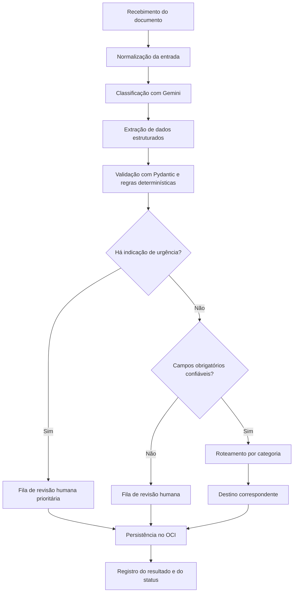

# MediFlow — Agente Inteligente de Triagem Clínica

**Hackathon ONE · Grupo 3**

## 1. Sobre o projeto

O MediFlow é um sistema inteligente desenvolvido para automatizar a triagem, a extração de informações e o roteamento de documentos clínicos e administrativos.

A solução utiliza Inteligência Artificial Generativa para identificar o tipo de documento recebido, extrair informações relevantes, avaliar a consistência dos dados e direcionar cada documento ao setor apropriado.

Quando são identificados dados incompletos, inconsistências ou baixa confiança na extração, o sistema encaminha o caso para revisão humana (*Human-in-the-Loop*).

A IA também analisa o conteúdo para sugerir a prioridade clínica e identificar uma possível situação de urgência. Documentos marcados como potencialmente urgentes são encaminhados para revisão humana prioritária, independentemente do score de confiança.

O projeto tem como objetivo reduzir o trabalho manual, minimizar erros de transcrição e contribuir para maior agilidade no processamento documental em hospitais, clínicas, laboratórios e operadoras de saúde.

## 2. Problema e justificativa

Instituições de saúde recebem diariamente grandes volumes de receitas médicas, laudos, pedidos de exames, guias de autorização e relatórios clínicos.

O processamento manual desses documentos pode gerar atrasos, erros de digitação, dificuldades de organização e demora no encaminhamento de solicitações prioritárias.

O MediFlow propõe automatizar parte desse processo por meio de um agente inteligente capaz de interpretar documentos, estruturar informações e aplicar regras de decisão para definir o encaminhamento adequado.

A solução combina inteligência artificial, validações determinísticas e revisão humana para equilibrar agilidade, rastreabilidade e segurança no processamento documental.

## 3. Objetivos

### 3.1. Objetivo geral

Desenvolver um MVP de um agente inteligente capaz de receber documentos clínicos, classificá-los, extrair dados estruturados e realizar o roteamento automatizado conforme regras de prioridade, confiança e consistência.

### 3.2. Objetivos específicos

- Receber documentos em texto, PDF e imagem.
- Classificar automaticamente os tipos de documentos.
- Extrair dados clínicos e administrativos relevantes.
- Validar a estrutura e a consistência das informações.
- Avaliar a confiança da extração por campo.
- Identificar situações potencialmente urgentes.
- Encaminhar casos incertos para revisão humana.
- Priorizar documentos potencialmente urgentes, independentemente do score.
- Encaminhar documentos aos destinos definidos.
- Armazenar documentos e resultados no Oracle Cloud Infrastructure (OCI) Object Storage.
- Disponibilizar uma interface para envio, consulta e revisão dos resultados.
- Validar o funcionamento por meio de testes automatizados e cenários demonstrativos.

## 4. Tecnologias e ferramentas

| Tecnologia | Finalidade |
|---|---|
| Python | Linguagem principal do backend e do processamento |
| Google Gemini Flash | Classificação documental e extração estruturada por IA |
| `google-genai` | Integração com a API do Gemini |
| Pydantic | Validação dos dados e dos modelos de entrada e saída |
| FastAPI | Criação da API REST |
| PyMuPDF | Leitura e processamento de PDFs |
| Pillow | Tratamento de imagens |
| OCI Python SDK (`oci`) | Integração com o OCI Object Storage |
| React | Desenvolvimento da interface web principal |
| Streamlit | Interface complementar para triagem e revisão humana, caso adotada |
| LangGraph | Orquestração do fluxo de decisão, caso adotado |
| pytest | Testes automatizados |

**Observação:** React é a proposta de interface web principal. A equipe deverá confirmar se utilizará também um painel Streamlit e se adotará LangGraph. A inclusão de uma tecnologia nesta lista não significa que sua integração já esteja concluída.

## 5. Arquitetura da solução

A arquitetura proposta é composta por quatro componentes principais:

1. **Interface web:** permite enviar documentos e visualizar os resultados da triagem.
2. **API e processamento:** recebe os arquivos, normaliza as entradas e coordena a execução do agente.
3. **Agente inteligente:** utiliza o Gemini para classificar documentos e extrair informações, aplica validações e executa as regras de roteamento.
4. **Armazenamento em nuvem:** utiliza o OCI Object Storage para persistir documentos e resultados do processamento.

A comunicação entre os componentes deverá utilizar estruturas de dados definidas e validadas com Pydantic.

O fluxo deverá separar três conceitos:

- **Prioridade:** indica se o documento foi sinalizado como potencialmente urgente.
- **Status:** representa a etapa atual do processamento.
- **Destino:** identifica a fila ou o setor para o qual o documento será encaminhado.

Essa separação evita que um erro técnico seja confundido com uma decisão clínica ou administrativa.

## 6. Fluxo de processamento

O pipeline do MediFlow está organizado nas seguintes etapas:

1. **Ingestão:** recebe o documento em um formato suportado.
2. **Normalização:** prepara o arquivo para análise, incluindo a leitura do PDF ou o tratamento da imagem quando necessário.
3. **Classificação:** identifica a categoria documental e analisa a possível prioridade clínica.
4. **Extração:** obtém os dados disponíveis, como paciente, profissional solicitante, CRM, diagnóstico, CID-10, medicamentos, dosagens e exames.
5. **Validação:** verifica a estrutura, o preenchimento, a consistência dos dados e os indicadores de confiança.
6. **Verificação de urgência:** encaminha documentos potencialmente urgentes para a fila prioritária de revisão humana.
7. **Decisão por confiança:** para documentos não urgentes, avalia se os campos obrigatórios atendem ao limiar configurado.
8. **Roteamento:** encaminha documentos elegíveis para o destino correspondente à categoria.
9. **Persistência:** armazena o documento, os resultados e o registro da decisão no OCI Object Storage.

### 6.1. Diagrama da arquitetura de decisão



A verificação de urgência ocorre antes da decisão de roteamento automático por confiança.

Se o documento for marcado como potencialmente urgente, ele deverá ser encaminhado para revisão humana prioritária, independentemente de seus scores. Para documentos não urgentes, a confiança insuficiente ou a existência de inconsistências nos campos obrigatórios também deverá acionar a revisão humana.

Somente documentos não urgentes, com dados obrigatórios suficientemente confiáveis e validações aprovadas, poderão seguir para o roteamento automático.

A sinalização produzida pela IA é um mecanismo de triagem e não substitui a avaliação de um profissional de saúde. A equipe deverá definir como os alertas prioritários serão apresentados e monitorados.

## 7. Regras de decisão e roteamento

O agente deverá considerar fatores independentes:

- **Prioridade clínica:** sinalização de possível urgência.
- **Confiança da extração:** indicador de confiabilidade atribuído aos dados extraídos.
- **Validação determinística:** verificação de campos obrigatórios, formatos e consistência.
- **Categoria documental:** classificação usada para selecionar o destino.

A revisão humana representa uma necessidade de validação por uma pessoa, e não uma categoria de prioridade clínica.

### 7.1. Limiar de confiança

O limiar inicial de referência é `0,80` (80%). Esse valor deverá ser configurável e validado pela equipe antes da implementação definitiva.

O score deverá ser avaliado por campo obrigatório, sem depender exclusivamente da média geral do documento.

Exemplo de scores de referência:

| Campo | Score
|---|---:|
| Paciente | 0,98 
| CRM | 0,45 
| Medicamento | 0,92 
| Dosagem | 0,90 

Neste exemplo, o CRM apresenta score inferior a `0,80`. Se o campo for obrigatório para o tipo documental em questão, o documento deverá ser encaminhado para revisão humana, mesmo que os demais campos apresentem scores elevados.

Os valores acima são exemplos para demonstrar a regra. Eles não representam resultados de uma avaliação de modelo já realizada.

**Importante:** scores fornecidos por um modelo de IA não são necessariamente probabilidades calibradas. Eles devem ser tratados como indicadores de confiança até que a equipe valide seu comportamento por meio de testes e dados representativos.

### 7.2. Regras de decisão

| Cenário | Decisão esperada |
|---|---|
| Documento potencialmente urgente, com score alto ou baixo | Revisão humana prioritária |
| Documento não urgente com campo obrigatório abaixo do limiar | Revisão humana |
| Documento não urgente com dados inconsistentes ou obrigatórios ausentes | Revisão humana |
| Documento não urgente, com confiança suficiente e validações aprovadas | Roteamento automático |
| Falha técnica durante o processamento | Status `erro`, registro da falha e tratamento de contingência |

A equipe deverá definir a fórmula final de confiança e quais campos serão obrigatórios para cada categoria documental. A validação do CRM, por exemplo, deverá verificar presença e formato, sem presumir que isso comprova a validade do registro profissional.

### 7.3. Destinos previstos

- `Fila_Revisao_Humana_Prioritaria`: documentos marcados como potencialmente urgentes.
- `Fila_Revisao_Humana`: documentos não urgentes com baixa confiança, ambiguidades ou dados incompletos.
- `Auditoria_Autorizacoes`: documentos relacionados à auditoria e às autorizações.
- `Farmacia_Hospitalar`: documentos destinados ao fluxo da farmácia hospitalar.
- `Prontuario_Eletronico`: documentos destinados ao prontuário eletrônico.

Os nomes acima representam identificadores lógicos propostos para o roteamento. Os identificadores internos deverão permanecer estáveis, independentemente dos rótulos apresentados na interface.

O erro de processamento será registrado como status, e não como destino de roteamento.

## 8. Contrato de dados

O sistema utilizará estruturas JSON para representar a entrada e a resposta do processamento. O arquivo `schema.py` deverá definir os modelos Pydantic correspondentes.

### 8.1. Entrada

A entrada poderá contemplar os seguintes campos:

| Campo | Descrição |
|---|---|
| `documento_id` | Identificador único do documento |
| `tipo_arquivo` | Formato do arquivo, definido por enum |
| `documento_texto` | Conteúdo textual, quando disponível |
| `documento_base64` | Conteúdo codificado do arquivo, quando utilizado |
| `canal_origem` | Origem do documento, definida por enum |

Os formatos iniciais poderão incluir `PDF`, `PNG`, `JPEG` e `TXT`, conforme os formatos efetivamente implementados.

O campo `canal_origem` deverá utilizar um conjunto controlado de valores definido pela equipe. Essa abordagem evita variações como `Pronto Socorro`, `pronto_socorro` e `PRONTO_SOCORRO`.

O sistema deverá validar os dados de entrada e rejeitar formatos não suportados.

### 8.2. Saída

A resposta deverá ser estruturada em blocos:

- `documento_id`: identificador do documento.
- `status`: estado atual do processamento.
- `classificacao`: tipo documental, especialidade, prioridade e confiança da classificação.
- `dados_extraidos`: informações do paciente, profissional solicitante e dados clínicos identificados.
- `scores_por_campo`: indicadores de confiança dos campos extraídos.
- `decisao_roteamento`: destino, necessidade de revisão, justificativa e eventual notificação.
- `armazenamento_oci`: bucket, caminho do objeto e estado da persistência.
- `historico_revisao`: registro das ações de revisão humana, quando existentes.

Exemplo ilustrativo de resposta:

```json
{
  "documento_id": "DOC-0001",
  "status": "em_auditoria",
  "classificacao": {
    "tipo_documento": "receita_medica",
    "prioridade": "rotina",
    "urgente": false
  },
  "scores_por_campo": {
    "paciente": 0.98,
    "crm": 0.45,
    "medicamento": 0.92,
    "dosagem": 0.90
  },
  "decisao_roteamento": {
    "destino": "Fila_Revisao_Humana",
    "motivo": "Score do CRM abaixo do limiar de referência"
  },
  "armazenamento_oci": {
    "persistido": true
  }
}
```

Os valores deste exemplo são fictícios e demonstram a estrutura esperada, não uma execução real do sistema.

### 8.3. Status do processamento

O campo `status` deverá utilizar um enum com os seguintes valores:

| Status | Significado | Armazenamento lógico sugerido |
|---|---|---|
| `recebido` | Documento recebido, aguardando processamento | `recebidos/` |
| `processando` | Processamento em andamento | `recebidos/` |
| `processado` | Documento processado e encaminhado com sucesso | `processados/` |
| `em_auditoria` | Documento aguardando revisão humana | `auditoria_humana/` |
| `aprovado_auditoria` | Documento revisado e aprovado por uma pessoa | `processados/` |
| `rejeitado` | Documento rejeitado explicitamente por uma pessoa, com motivo registrado | `rejeitados/` |
| `erro` | Falha técnica no processamento | `falhas_processamento/` |

O status representa o estado do processamento e não substitui os campos de prioridade, destino ou decisão de roteamento.

O status `erro` deverá ser usado para falhas técnicas, como indisponibilidade de API, arquivo corrompido ou exceção não tratada. O status `rejeitado` deverá representar uma decisão explícita de rejeição humana, com justificativa registrada.

A revisão humana deverá registrar o responsável, a data, a decisão, as correções realizadas e a justificativa aplicável.

A equipe deverá implementar os status como enum e manter os mesmos valores no frontend, backend e documentação.

## 9. Armazenamento no OCI Object Storage

O Oracle Cloud Infrastructure Object Storage será utilizado para armazenar os documentos recebidos e os resultados da triagem.

A organização proposta utiliza prefixos lógicos no bucket:

```text
mediflow-documentos-clinicos/
├── recebidos/
├── processados/
├── auditoria_humana/
├── rejeitados/
└── falhas_processamento/
```

Os prefixos representam uma organização lógica dentro do bucket, não necessariamente diretórios físicos.

### 9.1. Regras de armazenamento

- `recebidos/`: documentos recém-recebidos e arquivos em processamento.
- `processados/`: documentos processados com sucesso e documentos aprovados após auditoria.
- `auditoria_humana/`: documentos aguardando revisão humana.
- `rejeitados/`: documentos explicitamente rejeitados, acompanhados do registro da decisão.
- `falhas_processamento/`: arquivos cujo processamento falhou e que precisam de análise técnica ou reprocessamento.

O status deverá ser persistido nos metadados ou em uma base de dados apropriada. O sistema não deverá depender exclusivamente do caminho do arquivo para identificar o estado atual.

Quando um documento for revisado, corrigido e aprovado por uma pessoa, o sistema deverá atualizar o status para `aprovado_auditoria`, salvar o resultado revisado e registrar o histórico da decisão.

O documento não deverá ser reenviado automaticamente à IA após a aprovação humana. Se um novo processamento for necessário, ele deverá ocorrer por meio de uma ação explícita, autorizada e registrada.

A integração com o OCI Object Storage faz parte dos requisitos do MVP. A implementação deverá respeitar as permissões, a configuração da conta e os limites de recursos aplicáveis ao projeto.

## 10. Requisitos funcionais

- **RF-01:** receber documentos nos formatos suportados.
- **RF-02:** identificar o tipo documental e sinalizar a possível prioridade clínica.
- **RF-03:** extrair dados clínicos e administrativos relevantes.
- **RF-04:** identificar ambiguidades, inconsistências e dados ausentes, validando os campos obrigatórios.
- **RF-05:** avaliar a confiança dos campos extraídos e aplicar o limiar configurado.
- **RF-06:** encaminhar documentos potencialmente urgentes para revisão humana prioritária, independentemente do score.
- **RF-07:** encaminhar documentos não urgentes com baixa confiança para revisão humana.
- **RF-08:** encaminhar automaticamente documentos elegíveis ao destino correspondente.
- **RF-09:** gerar uma resposta estruturada em JSON.
- **RF-10:** persistir documentos e resultados no OCI Object Storage.
- **RF-11:** permitir a revisão humana dos casos sinalizados.
- **RF-12:** registrar correções, aprovações, rejeições e justificativas da revisão.
- **RF-13:** salvar documentos aprovados após revisão sem reenviá-los automaticamente à IA.
- **RF-14:** registrar falhas técnicas com status `erro` e armazenar os arquivos na área de contingência.
- **RF-15:** validar `tipo_arquivo` e `canal_origem` por meio de enums.

Os requisitos deverão ser verificados por testes e cenários demonstrativos antes da entrega final do MVP.

## 11. Requisitos não funcionais

- **RNF-01 — Linguagem:** desenvolver o backend em Python.
- **RNF-02 — Modelo de IA:** utilizar um modelo compatível com os requisitos e limites do projeto.
- **RNF-03 — Validação:** validar os dados de entrada e saída com estruturas definidas.
- **RNF-04 — Manutenibilidade:** organizar o código em módulos com responsabilidades claras.
- **RNF-05 — Tratamento de falhas:** prever erros de processamento e caminhos de contingência.
- **RNF-06 — Segurança:** proteger documentos clínicos, credenciais e permissões de acesso.
- **RNF-07 — Armazenamento:** utilizar os recursos de nuvem permitidos pelo programa.
- **RNF-08 — Testabilidade:** permitir testes automatizados dos principais fluxos.
- **RNF-09 — Rastreabilidade:** registrar as decisões de roteamento e as ações de revisão humana.
- **RNF-10 — Consistência:** manter enums, status e contratos de dados alinhados entre frontend e backend.

## 12. Plano de testes e demonstração

O MVP deverá demonstrar pelo menos quatro cenários.

### Cenário 1 — Documento de rotina

Um documento sintético, legível e sem indicação de urgência é recebido, classificado, validado e encaminhado automaticamente.

**Resultado esperado:** dados estruturados válidos, status `processado` e registro do destino selecionado.

### Cenário 2 — Documento potencialmente urgente

Um documento sintético contém informações que levam o sistema a sinalizar possível urgência.

**Resultado esperado:** o documento é encaminhado para `Fila_Revisao_Humana_Prioritaria`, independentemente de o score ser alto ou baixo.

### Cenário 3 — Documento com baixa confiança

Um documento sintético apresenta um ou mais campos obrigatórios com score inferior ao limiar, como o CRM com score `0,45`.

**Resultado esperado:** o documento é encaminhado para `Fila_Revisao_Humana`, desde que não tenha sido sinalizado como potencialmente urgente.

### Cenário 4 — Falha técnica

O processamento falha devido a um arquivo inválido ou a uma indisponibilidade de serviço.

**Resultado esperado:** status `erro`, registro técnico da falha e armazenamento do arquivo na área de contingência, conforme as regras implementadas.

### 12.1. Testes automatizados

Os testes com `pytest` deverão verificar:

- Validação do schema e dos enums.
- Extração e validação dos campos obrigatórios.
- Aplicação do limiar de confiança.
- Encaminhamento de documentos não urgentes com baixa confiança.
- Encaminhamento prioritário de documentos urgentes com score alto ou baixo.
- Roteamento automático de documentos elegíveis.
- Tratamento de erros e falhas de integração.
- Persistência dos documentos e resultados no OCI.
- Transições de status.
- Registro das decisões e do histórico de revisão.
- Aprovação e rejeição humanas.
- Ausência de reenvio automático à IA após a aprovação humana.

Os testes deverão utilizar documentos sintéticos sempre que possível, evitando a exposição de informações clínicas reais.

## 13. Segurança e limitações

O MediFlow é um projeto de automação documental e triagem. A classificação produzida pela IA não deve ser considerada um diagnóstico médico definitivo nem substituir a avaliação profissional.

Para proteger informações sensíveis, o desenvolvimento deverá priorizar:

- Utilização de documentos sintéticos nos testes e nas demonstrações.
- Proteção das credenciais por variáveis de ambiente ou mecanismos adequados de gerenciamento de segredos.
- Controle de acesso aos documentos armazenados.
- Registro mínimo de informações pessoais e clínicas nos logs.
- Revisão humana dos casos incertos.
- Priorização da revisão humana de documentos potencialmente urgentes.
- Registro das decisões e das correções realizadas por pessoas.
- Ausência de reprocessamento automático após aprovação humana.
- Tratamento adequado de falhas de integração e indisponibilidade de serviços.

O uso de documentos clínicos reais exigirá controles de segurança, privacidade e conformidade adequados, incluindo a legislação aplicável de proteção de dados.

A equipe também deverá considerar os riscos de falsos positivos e falsos negativos na identificação de urgência. O mecanismo de triagem precisa ser testado, monitorado e apresentado como apoio ao fluxo de trabalho, não como substituto de protocolos clínicos.

## 14. Como executar

As instruções definitivas deverão ser atualizadas após a implementação dos componentes e a definição dos pontos de entrada do projeto.

### 14.1. Pré-requisitos

- Python em versão compatível com as dependências.
- Node.js e npm, caso seja utilizado o frontend React.
- Chave de API do Google Gemini.
- Configuração de acesso ao OCI Object Storage.
- Git instalado.
- Arquivos de configuração de dependências do projeto.

### 14.2. Clonar o repositório

Substitua `<URL_DO_REPOSITORIO>` pelo endereço real do repositório:

```bash
git clone <URL_DO_REPOSITORIO>
cd mediflow
```

### 14.3. Criar e ativar o ambiente Python

Criar o ambiente virtual:

```bash
python -m venv .venv
```

**Windows — PowerShell:**

```powershell
.venv\Scripts\Activate.ps1
```

**Linux/macOS:**

```bash
source .venv/bin/activate
```

### 14.4. Instalar dependências

Após a criação do arquivo `requirements.txt`:

```bash
pip install -r requirements.txt
```

### 14.5. Configurar variáveis de ambiente

O arquivo `.env.example` deverá documentar as variáveis necessárias, como a chave da API e as configurações de integração com OCI.

Não adicionar chaves, senhas ou credenciais reais ao repositório.

### 14.6. Iniciar os serviços

Os comandos para iniciar a API, o frontend React e um eventual painel Streamlit deverão ser adicionados quando seus respectivos pontos de entrada estiverem definidos.

**Observação:** esta seção é um modelo inicial. Os comandos dependem da estrutura real do repositório e dos componentes efetivamente implementados.

## 15. Estrutura sugerida do repositório

```text
mediflow/
├── backend/
│   ├── main.py
│   ├── schema.py
│   ├── services/
│   ├── agent/
│   ├── routing/
│   └── storage/
├── frontend/
│   └── src/
├── tests/
├── docs/
│   └── arquitetura.md
├── .env.example
├── .gitignore
├── requirements.txt
└── README.md
```

A estrutura é uma proposta inicial e deverá acompanhar a organização real do código.

- `backend/`: API, processamento e regras de negócio.
- `backend/services/`: serviços auxiliares e integrações.
- `backend/agent/`: classificação e extração com IA.
- `backend/routing/`: regras de decisão e roteamento.
- `backend/storage/`: integração com o OCI Object Storage.
- `frontend/`: interface web.
- `tests/`: testes automatizados.
- `docs/`: arquitetura e documentação complementar.
- `.env.example`: exemplo das variáveis necessárias, sem credenciais reais.

Caso o Streamlit seja adotado, seu painel poderá ficar em um módulo próprio.

## 16. Equipe e informações do projeto

**Projeto:** MediFlow  
**Programa:** Oracle Next Education (ONE) + Alura  
**Equipe:** Grupo 3

---

*Este documento descreve a proposta técnica do MediFlow. A arquitetura, os contratos de dados, os status, os valores de confiança e as integrações deverão ser validados pela equipe e atualizados conforme os componentes forem implementados e testados.*
